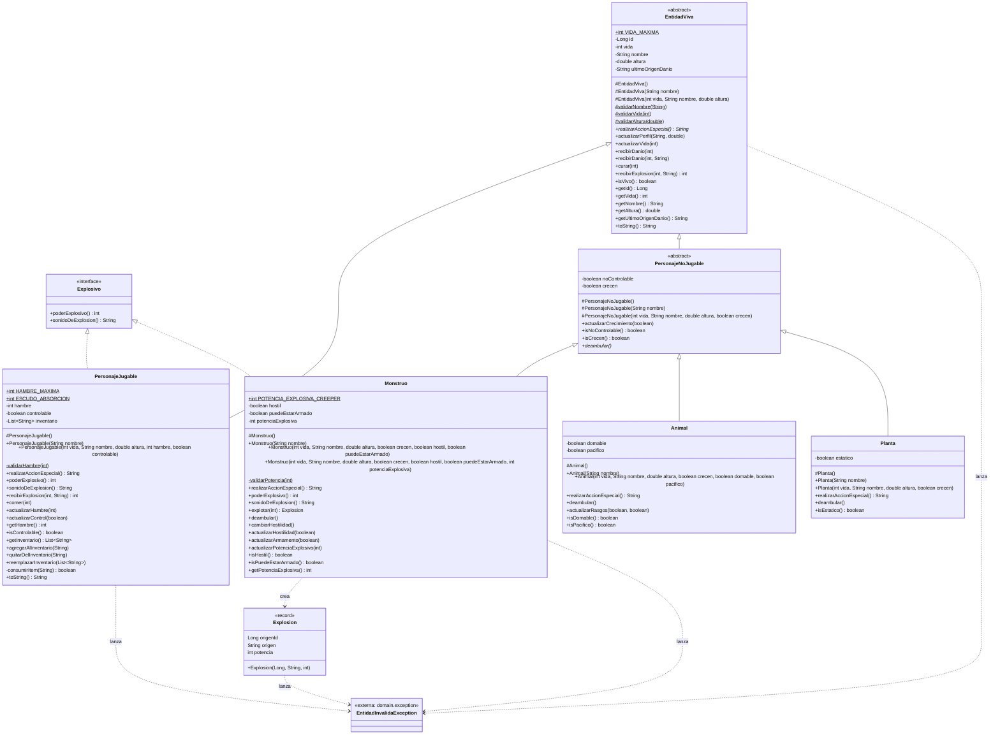
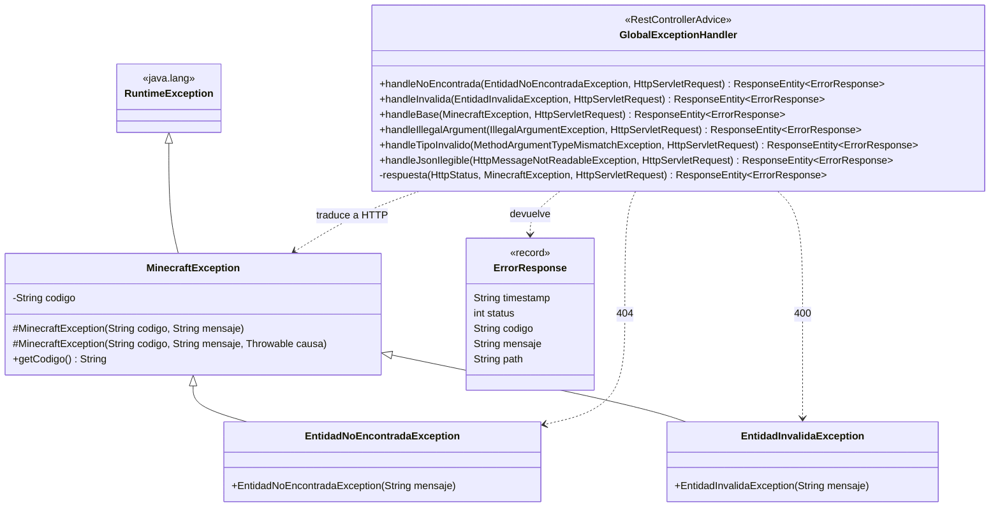
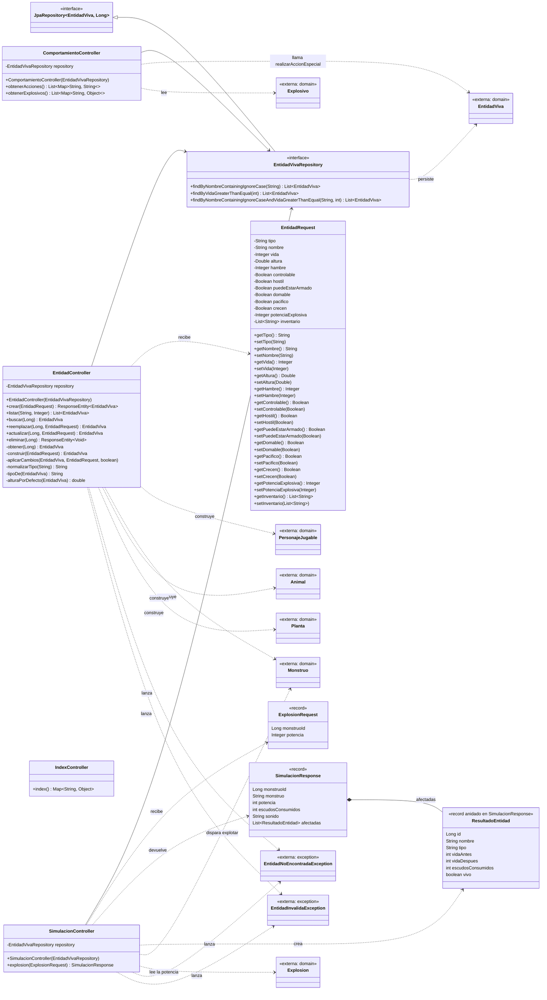

# Minecraft - Servicio REST con Spring Boot y H2 (POO-08)

Servicio HTTP sobre el modelado de **Minecraft**. Guarda su estado en una base **H2**, expone un CRUD REST sobre las entidades vivas del juego y simula **explosiones** que cambian el estado de varios objetos a la vez.

- Autor: Adrian Vera
- Asignatura: Lenguaje de Programación 3 (CYT646)

## Cómo arrancar

```bash
./mvnw spring-boot:run        # Linux / macOS / Git Bash
mvnw.cmd spring-boot:run      # Windows (CMD o PowerShell)
```

El servicio queda en <http://localhost:8080/> y la consola de la base en <http://localhost:8080/h2-console>. Las instrucciones completas de ejecución, prueba y solución de problemas están en [`RUN.md`](RUN.md).

## Propiedades de H2 (`application.properties`)

| Propiedad | Qué hace |
|---|---|
| `spring.application.name` | Nombre de la aplicación. |
| `spring.datasource.url=jdbc:h2:file:./data/minecraft;AUTO_SERVER=TRUE` | Guarda la base en un archivo dentro de `./data`, por lo que el estado sobrevive a un reinicio. `AUTO_SERVER=TRUE` permite abrirla desde otro proceso mientras el servicio corre. |
| `spring.datasource.username` / `password` | Credenciales de H2: usuario `sa` y contraseña vacía (valores por defecto de desarrollo). |
| `spring.datasource.driver-class-name=org.h2.Driver` | Driver JDBC con el que Java habla con H2. |
| `spring.jpa.hibernate.ddl-auto=update` | Hibernate crea o ajusta las tablas a partir de las anotaciones de las entidades, sin borrar datos. |
| `spring.jpa.show-sql=true` | Muestra en la consola el SQL que se ejecuta. |
| `spring.jpa.properties.hibernate.format_sql=true` | Imprime ese SQL con formato legible. |
| `spring.jpa.open-in-view=false` | La sesión de base de datos no queda abierta durante toda la petición HTTP: el acceso a datos queda en el repositorio y las transacciones. |
| `spring.h2.console.enabled=true` | Habilita la consola web de H2 (solo para desarrollo). |
| `spring.h2.console.path=/h2-console` | URL de esa consola. |

## Endpoints

| Verbo y URL | Qué hace | Éxito |
|---|---|---|
| `GET /` | Confirma que el servicio vive | 200 |
| `POST /minecraft/entidades` | Crea una entidad (`tipo`: jugador, monstruo, animal o planta) | 201 |
| `GET /minecraft/entidades` | Lista; filtros opcionales `nombre` y `vidaMinima` | 200 |
| `GET /minecraft/entidades/{id}` | Devuelve una entidad | 200 |
| `PUT /minecraft/entidades/{id}` | Reemplaza la entidad completa | 200 |
| `PATCH /minecraft/entidades/{id}` | Cambia solo los campos enviados | 200 |
| `DELETE /minecraft/entidades/{id}` | Elimina la entidad | 204 |
| `GET /minecraft/explosivos` | Todo lo que implementa la interface `Explosivo` | 200 |
| `GET /minecraft/acciones` | Acción especial de cada entidad (polimorfismo) | 200 |
| `POST /minecraft/simulacion/explosion` | Simula la explosión de un monstruo | 200 |

Errores (JSON con `timestamp`, `status`, `codigo`, `mensaje` y `path`):

| Excepción | Código HTTP | `codigo` |
|---|---|---|
| `EntidadNoEncontradaException` | 404 | `ENTIDAD_NO_ENCONTRADA` |
| `EntidadInvalidaException` | 400 | `ENTIDAD_INVALIDA` |
| JSON ilegible (Spring) | 400 | `CUERPO_ILEGIBLE` |
| Parámetro con tipo inválido (por ejemplo `/minecraft/entidades/abc`) | 400 | `PARAMETRO_INVALIDO` |

## Diagrama

El diagrama se divide en tres capas para que sea legible: dominio, excepciones y capa REST con persistencia. Las clases marcadas como `externa` solo anclan las relaciones con otra capa.

### 1. Dominio (`domain`)



### 2. Excepciones y manejo de errores (`domain.exception` y `rest.exception`)



### 3. REST y persistencia (`rest.controller`, `rest.dto`, `repository`)



- **Herencia** (`<|--`): `PersonajeJugable` y `PersonajeNoJugable` son entidades vivas; `Monstruo`, `Animal` y `Planta` son personajes no jugables.
- **Implementación de interface** (`<|..`): `PersonajeJugable` y `Monstruo`, de familias distintas, implementan `Explosivo`.
- **Uso del repositorio** (`..>`): los tres controllers hablan con la interface `EntidadVivaRepository`, nunca con una implementación.
- **Jerarquía de excepciones**: `MinecraftException` es la base; las dos hijas son `EntidadNoEncontradaException` y `EntidadInvalidaException`.

Las tres clases persistidas que participan en la simulación son `EntidadViva` (padre), `PersonajeJugable` y `Monstruo` (hijas). `Animal` y `Planta` también se guardan en la misma tabla.

## Las dos reglas del juego

1. **Monstruo explosivo** (`Monstruo.explotar`): un monstruo hostil y vivo explota con una potencia entre 1 y su máximo y se autodestruye (su vida llega a 0).
2. **Escudos del jugador** (`PersonajeJugable.recibirExplosion`): cada escudo del inventario absorbe 5 puntos de la onda expansiva y se consume.

`POST /minecraft/simulacion/explosion` aplica la explosión a todas las entidades guardadas (jugadores, monstruos, animales y plantas) y persiste las nuevas vidas y los escudos consumidos.

**Qué pasa con el Creeper:** "autodestruirse" significa quedar con `vida: 0` y `vivo: false`, no desaparecer de la base. La fila sigue guardada y aparece en el listado, y sirve de prueba: una segunda explosión con el mismo Creeper devuelve 400 porque "ya no está vivo". Borrar una entidad es otra operación, `DELETE`.

## Invariantes

- Vida entre 0 y 20; altura mayor que 0 y hasta 10; nombre no vacío.
- Hambre del jugador entre 0 y 20.
- Potencia explosiva de un monstruo entre 1 y 50.
- Una `Explosion` exige origen no vacío y potencia mayor que cero.
- Un monstruo muerto o no hostil no puede explotar, y su potencia no puede superar su máximo.
- Un ítem del inventario no puede estar vacío.

Un `POST` que viola cualquiera de estas reglas devuelve 400 y no deja nada en la base.

## Cómo probar (recorrido de 5 a 10 minutos)

1. `GET /` devuelve "Servicio activo".
2. `POST /minecraft/entidades` válido devuelve 201 y un `id`.
3. `GET /minecraft/entidades` muestra el recurso creado.
4. `GET /minecraft/entidades/{id}` coincide con lo creado.
5. `PUT` o `PATCH` cambia un campo y un `GET` posterior lo conserva.
6. `POST` ilegal (por ejemplo `vida: 99`) devuelve 400 y la colección no crece.
7. `DELETE` devuelve 204 y un `GET` posterior devuelve 404.
8. `GET /minecraft/explosivos` devuelve el JSON de la interface.
9. La simulación cambia las vidas y un `GET` posterior las muestra ya guardadas.
10. Cada excepción hija responde distinto: 404 `ENTIDAD_NO_ENCONTRADA` y 400 `ENTIDAD_INVALIDA`.

La colección de Insomnia hace exactamente este recorrido (ver más abajo).

## Respuestas a "Qué hay que pensar"

- **Recurso y verbo:** el sustantivo es `entidades` (`/minecraft/entidades`). La URL nombra el recurso y el verbo HTTP dice la operación; la simulación es su propio recurso (`/minecraft/simulacion/explosion`).
- **Identidad:** la clave es `id`, un número que asigna la base (`GenerationType.IDENTITY`). El JSON de creación lo omite y la respuesta lo trae.
- **Herencia y tablas:** usamos `SINGLE_TABLE`: toda la jerarquía vive en `entidad_viva`, con la columna `tipo_entidad` que distingue el subtipo. Elegimos esa estrategia porque las consultas y la simulación recorren todas las entidades a la vez, sin joins, a costa de tener columnas vacías según el tipo. En el JSON el subtipo se distingue con el campo `tipo` (`@JsonTypeInfo` y `@JsonSubTypes` en `EntidadViva`).
- **Interfaz y repositorio:** `EntidadVivaRepository` es una interface que Spring implementa solo. El controller depende del tipo, no de una clase concreta, así que se podría cambiar H2 por otra base sin tocar los controllers. Es la misma idea que el protocolo `Explosivo` de POO-07: se programa contra un contrato.
- **Protocolo del dominio:** la interface es `Explosivo` (`poderExplosivo()` y un `sonidoDeExplosion()` por defecto). `GET /minecraft/explosivos` la usa y mezcla instancias de dos familias distintas (`PersonajeJugable` y `Monstruo`).
- **Ocultamiento:** las reglas numéricas las sostienen las propias clases del dominio (`validarVida`, `validarHambre`, `validarPotencia`, el constructor de `Explosion`). Los constructores sin argumentos que pide JPA son `protected`, no hay setters públicos y JPA accede a los campos directamente. Prueba en Insomnia: el `POST ilegal` devuelve 400 y el `GET` posterior muestra que la colección no cambió.
- **PUT y PATCH:** `PUT` reemplaza el recurso entero (exige `nombre`; lo omitido vuelve a su valor por defecto). `PATCH` cambia solo los campos enviados y deja el resto como estaba.
- **DELETE:** es un borrado físico (`repository.delete`): la fila desaparece y un `GET` posterior devuelve 404. No usa un mensaje especial del dominio.
- **Dos reglas:** una explosión cambia el estado de más de un objeto a la vez: el monstruo se autodestruye, los jugadores gastan escudos y reciben daño, y animales y plantas reciben el daño completo. El Creeper no se borra: queda con vida 0. El recurso HTTP es `/minecraft/simulacion/explosion` y un `GET` posterior a `/minecraft/entidades` muestra el resultado ya persistido.
- **Excepciones:** `MinecraftException` es la base y lleva un `codigo`. `EntidadNoEncontradaException` (404) se lanza cuando el recurso no existe; `EntidadInvalidaException` (400) cuando se rompe un invariante o una regla del juego. Son tipos distintos porque el cliente reacciona distinto: "no existe" no es lo mismo que "lo que enviaste es ilegal". Son excepciones **no comprobadas** (`RuntimeException`): el dominio las lanza sin llenar de `throws` cada firma, y Spring revierte la transacción cuando se lanzan. Las lanzan los objetos del juego, no el controller; el controller solo lanza `EntidadNoEncontradaException` cuando el repositorio no encuentra el id. El JSON de error lleva `timestamp`, `status`, `codigo`, `mensaje` y `path`.
- **Si cambiamos H2 por otra base:** se toca el `pom.xml` (el driver) y `application.properties` (la URL). Las entidades, el repositorio y los controllers se quedan quietos.

## Colección de Insomnia

Archivo: [`insomnia/minecraft-insomnia.json`](insomnia/minecraft-insomnia.json)

**Importar:** abrí Insomnia, elegí *Import* y luego *From File*, y seleccioná el archivo. Se crea la colección "Minecraft - POO-08" con un entorno (*Base Environment*) que define `base_url` y los ids `jugador_id`, `monstruo_id`, `animal_id` e `id_inexistente`.

**Orden de ejecución** (arrancando con la carpeta `data/` borrada, los ids serán 1, 2 y 3):

1. `00 - Estado`: `GET /`.
2. `01 - CRUD`: los tres `POST` (jugador, monstruo, animal), luego `GET` de la lista, `GET` por id, `PUT`, `PATCH` y `GET` para ver que el cambio persiste. Si algún id de la respuesta no coincide con el del entorno, corregilo en *Manage Environments*. Si al importar el entorno queda vacío, cargá las variables en *Manage Environments*: apagá *Table View* y pegá el JSON con `base_url` (`http://localhost:8080`), `jugador_id` (1), `monstruo_id` (2), `animal_id` (3) e `id_inexistente` (9999).
3. `02 - Interface Explosivo`: `GET /minecraft/explosivos`.
4. `03 - Simulación`: `POST` de la explosión (caso feliz) y después los `GET` que muestran el estado ya persistido.
5. `04 - Errores`: un pedido por cada excepción (400 `ENTIDAD_INVALIDA`, 404 `ENTIDAD_NO_ENCONTRADA` y 400 `CUERPO_ILEGIBLE`). El orden importa: la carpeta usa al Creeper ya explotado y a la vaca todavía viva.
6. `05 - DELETE`: borra la vaca y confirma el 404.

## Estructura del proyecto

- `domain`: entidades, `Explosivo`, `Explosion` y `domain.exception` (excepciones).
- `repository`: `EntidadVivaRepository`.
- `rest.controller`: controllers HTTP. `rest.dto`: cuerpos de entrada y salida (incluye `ErrorResponse`). `rest.exception`: `GlobalExceptionHandler`, que traduce las excepciones a HTTP.
## Licencia

Este proyecto está distribuido bajo los términos de la [Licencia Apache 2.0](LICENSE).