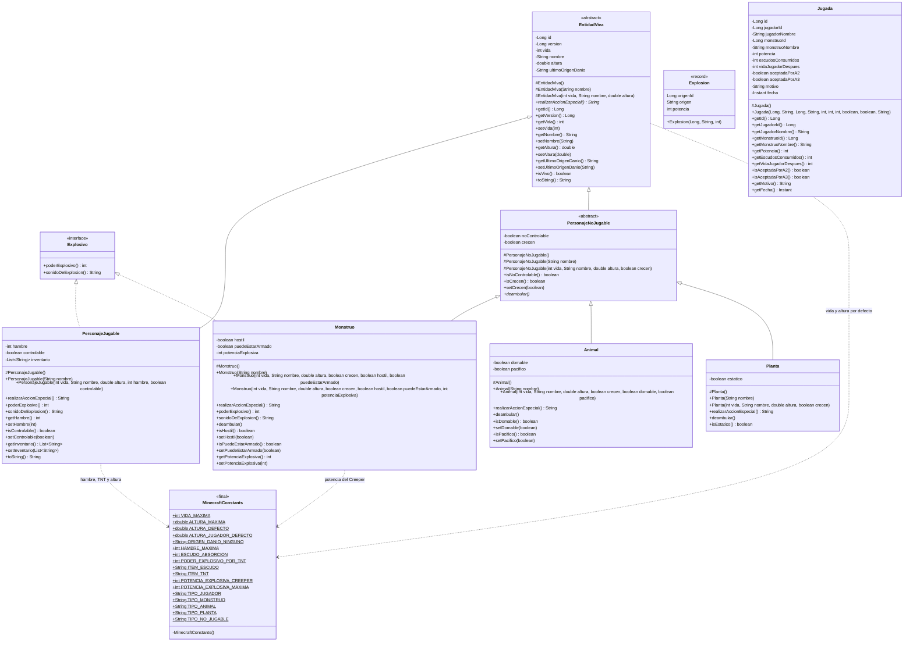
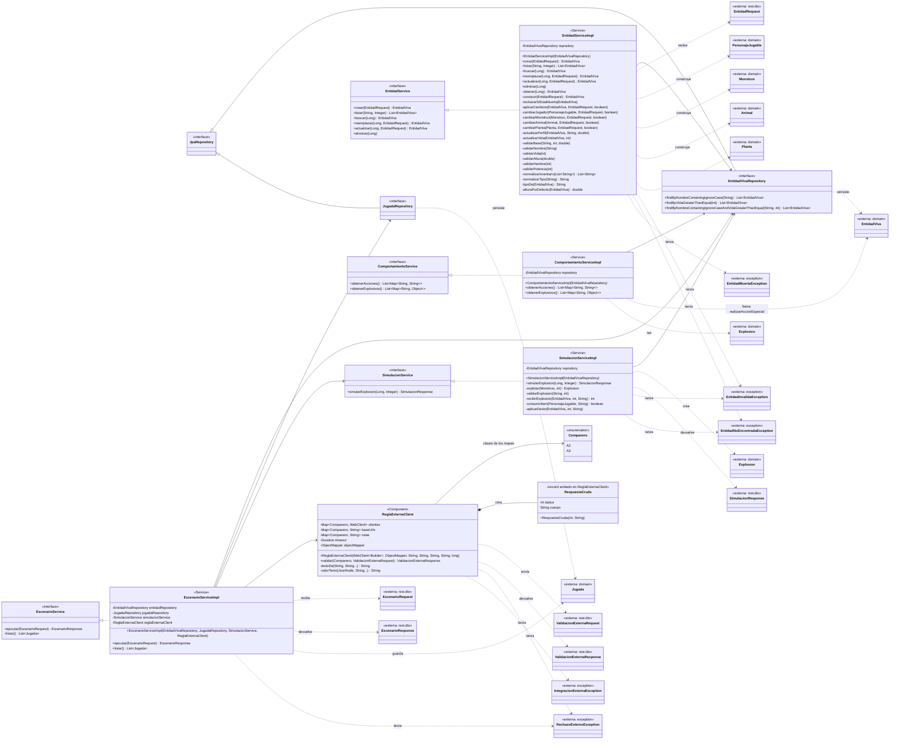

# Minecraft - Servicio REST con Spring Boot y H2 (POO-08 / POO-09)

Servicio HTTP sobre el modelado de **Minecraft**. Guarda su estado en una base **H2**, expone un CRUD REST sobre las entidades vivas del juego y simula **explosiones** que cambian el estado de varios objetos a la vez. En POO-09 se agregó un escenario que consulta a los compañeros A2 y A3 antes de persistir la jugada.

- Autor: Adrian Vera
- Asignatura: Lenguaje de Programación 3 (CYT646)
- Entrega POO-09: [documento aplicado](docs/POO09-APLICADO.md) · commit: `https://github.com/Adrian-312/avera-tplp3-2026/commit/<HASH_DEL_COMMIT>`

## Cómo arrancar

```bash
./mvnw spring-boot:run        # Linux / macOS / Git Bash
mvnw.cmd spring-boot:run      # Windows (CMD o PowerShell)
```

El servicio queda en <http://localhost:8080/> y la consola de la base en <http://localhost:8080/h2-console>. El OpenAPI propio está en <http://localhost:8080/v3/api-docs> y Swagger UI en <http://localhost:8080/swagger-ui.html>. Las instrucciones completas de ejecución, prueba y solución de problemas están en [`RUN.md`](RUN.md).

## Propiedades de H2 (`application.properties`)

| Propiedad | Qué hace |
|---|---|
| `spring.application.name` | Nombre de la aplicación. |
| `spring.datasource.url=jdbc:h2:file:./data/minecraft;AUTO_SERVER=TRUE` | Guarda la base en un archivo dentro de `./data`, por lo que el estado sobrevive a un reinicio. `AUTO_SERVER=TRUE` permite abrirla desde otro proceso mientras el servicio corre. |
| `spring.datasource.username` / `password` | Credenciales de H2: usuario `sa` y contraseña vacía (valores por defecto de desarrollo). |
| `spring.datasource.driver-class-name=org.h2.Driver` | Driver JDBC con el que Java habla con H2. |
| `spring.jpa.hibernate.ddl-auto=update` | Hibernate crea o ajusta las tablas a partir de las anotaciones de las entidades, sin borrar datos. |
| `spring.jpa.show-sql=true` | Muestra en la consola el SQL que se ejecuta. |
| `spring.jpa.properties.hibernate.format_sql=true` | Imprime ese SQL con formato legible. |
| `spring.jpa.open-in-view=false` | La sesión de base de datos no queda abierta durante toda la petición HTTP: el acceso a datos queda en el repositorio y las transacciones. |
| `spring.h2.console.enabled=true` | Habilita la consola web de H2 (solo para desarrollo). |
| `spring.h2.console.path=/h2-console` | URL de esa consola. |

## Endpoints

| Verbo y URL | Qué hace | Éxito |
|---|---|---|
| `GET /` | Confirma que el servicio vive | 200 |
| `POST /minecraft/entidades` | Crea una entidad (`tipo`: jugador, monstruo, animal o planta) | 201 |
| `GET /minecraft/entidades` | Lista; filtros opcionales `nombre` y `vidaMinima` | 200 |
| `GET /minecraft/entidades/{id}` | Devuelve una entidad | 200 |
| `PUT /minecraft/entidades/{id}` | Reemplaza la entidad completa | 200 |
| `PATCH /minecraft/entidades/{id}` | Cambia solo los campos enviados | 200 |
| `DELETE /minecraft/entidades/{id}` | Elimina la entidad | 204 |
| `GET /minecraft/explosivos` | Todo lo que implementa la interface `Explosivo` | 200 |
| `GET /minecraft/acciones` | Acción especial de cada entidad (polimorfismo) | 200 |
| `POST /minecraft/simulacion/explosion` | Simula la explosión de un monstruo | 200 |
| `POST /minecraft/escenarios/explosion-validada` | Consulta A2 y A3, simula y guarda la jugada | 201 |
| `GET /minecraft/escenarios` | Lista el historial de jugadas | 200 |
| `GET /v3/api-docs` / `GET /swagger-ui.html` | Documentación OpenAPI generada | 200 |

Errores (JSON con `timestamp`, `status`, `codigo`, `mensaje` y `path`):

| Excepción | Código HTTP | `codigo` |
|---|---|---|
| `EntidadNoEncontradaException` | 404 | `ENTIDAD_NO_ENCONTRADA` |
| `EntidadInvalidaException` | 400 | `ENTIDAD_INVALIDA` |
| `EntidadMuertaException` (`PUT`/`PATCH` sobre entidad muerta) | 409 | `ENTIDAD_MUERTA` |
| JSON ilegible (Spring) | 400 | `CUERPO_ILEGIBLE` |
| Parámetro con tipo inválido (por ejemplo `/minecraft/entidades/abc`) | 400 | `PARAMETRO_INVALIDO` |
| Rechazo de A2 / A3 | 400 | `RECHAZO_A2` / `RECHAZO_A3` |
| Fallo al consultar A2 / A3 | 502 | `FALLO_A2` / `FALLO_A3` |

## Diagrama

El diagrama se divide en cuatro capas para que sea legible: dominio, excepciones, servicios con persistencia e integración, y capa REST con DTOs y configuración. Las clases marcadas como `externa` solo anclan las relaciones con otra capa. `+`, `-` y `#` indican visibilidad pública, privada y protegida; `$` marca miembros estáticos y `*` miembros abstractos.

### 1. Dominio (`domain` y `constants`)



### 2. Excepciones y manejo de errores (`exception`)

```mermaid
classDiagram
    direction TB

    class RuntimeException {
        <<java.lang>>
    }

    class IllegalArgumentException {
        <<java.lang>>
    }

    class MethodArgumentTypeMismatchException {
        <<spring>>
    }

    class HttpMessageNotReadableException {
        <<spring>>
    }

    class MinecraftException {
        -String codigo
        #MinecraftException(String codigo, String mensaje)
        #MinecraftException(String codigo, String mensaje, Throwable causa)
        +getCodigo() String
    }

    class EntidadNoEncontradaException {
        +EntidadNoEncontradaException(String mensaje)
    }

    class EntidadInvalidaException {
        +EntidadInvalidaException(String mensaje)
    }

    class EntidadMuertaException {
        +EntidadMuertaException(String mensaje)
    }

    class IntegracionExternaException {
        -String companero
        +IntegracionExternaException(String companero, String mensaje)
        +getCompanero() String
    }

    class RechazoExternoException {
        -int statusExterno
        -String codigoExterno
        +RechazoExternoException(String companero, int statusExterno, String codigoExterno, String motivo)
        +getStatusExterno() int
        +getCodigoExterno() String
    }

    class GlobalExceptionHandler {
        <<RestControllerAdvice>>
        +handleNoEncontrada(EntidadNoEncontradaException, HttpServletRequest) ResponseEntity~ErrorResponse~
        +handleInvalida(EntidadInvalidaException, HttpServletRequest) ResponseEntity~ErrorResponse~
        +handleMuerta(EntidadMuertaException, HttpServletRequest) ResponseEntity~ErrorResponse~
        +handleRechazoExterno(RechazoExternoException, HttpServletRequest) ResponseEntity~ErrorResponse~
        +handleFalloExterno(IntegracionExternaException, HttpServletRequest) ResponseEntity~ErrorResponse~
        +handleBase(MinecraftException, HttpServletRequest) ResponseEntity~ErrorResponse~
        +handleIllegalArgument(IllegalArgumentException, HttpServletRequest) ResponseEntity~ErrorResponse~
        +handleTipoInvalido(MethodArgumentTypeMismatchException, HttpServletRequest) ResponseEntity~ErrorResponse~
        +handleJsonIlegible(HttpMessageNotReadableException, HttpServletRequest) ResponseEntity~ErrorResponse~
        -respuesta(HttpStatus, MinecraftException, HttpServletRequest) ResponseEntity~ErrorResponse~
    }

    class ErrorResponse {
        <<record>>
        String timestamp
        int status
        String codigo
        String mensaje
        String path
    }

    RuntimeException <|-- MinecraftException
    RuntimeException <|-- IntegracionExternaException
    MinecraftException <|-- EntidadNoEncontradaException
    MinecraftException <|-- EntidadInvalidaException
    MinecraftException <|-- EntidadMuertaException
    IntegracionExternaException <|-- RechazoExternoException

    GlobalExceptionHandler ..> MinecraftException : traduce a HTTP
    GlobalExceptionHandler ..> EntidadNoEncontradaException : 404 ENTIDAD_NO_ENCONTRADA
    GlobalExceptionHandler ..> EntidadInvalidaException : 400 ENTIDAD_INVALIDA
    GlobalExceptionHandler ..> EntidadMuertaException : 409 ENTIDAD_MUERTA
    GlobalExceptionHandler ..> RechazoExternoException : 400 RECHAZO_*
    GlobalExceptionHandler ..> IntegracionExternaException : 502 FALLO_*
    GlobalExceptionHandler ..> IllegalArgumentException : 400 ARGUMENTO_INVALIDO
    GlobalExceptionHandler ..> MethodArgumentTypeMismatchException : 400 PARAMETRO_INVALIDO
    GlobalExceptionHandler ..> HttpMessageNotReadableException : 400 CUERPO_ILEGIBLE
    GlobalExceptionHandler ..> ErrorResponse : devuelve
```



### 3. Servicios, repositorios e integración (`service`, `service.impl`, `repository`, `integration`)



### 4. REST, DTOs y configuración (`rest.controller`, `rest.dto`, `config`, `constants`)

```mermaid
classDiagram
    direction LR

    class EntidadController {
        <<RestController>>
        -EntidadService service
        +EntidadController(EntidadService)
        +crear(EntidadRequest) ResponseEntity~EntidadViva~
        +listar(String, Integer) List~EntidadViva~
        +buscar(Long) EntidadViva
        +reemplazar(Long, EntidadRequest) EntidadViva
        +actualizar(Long, EntidadRequest) EntidadViva
        +eliminar(Long) ResponseEntity~Void~
    }
    class SimulacionController {
        <<RestController>>
        -SimulacionService service
        +SimulacionController(SimulacionService)
        +explosion(ExplosionRequest) SimulacionResponse
    }
    class ComportamientoController {
        <<RestController>>
        -ComportamientoService service
        +ComportamientoController(ComportamientoService)
        +obtenerAcciones() List~Map~String, String~~
        +obtenerExplosivos() List~Map~String, Object~~
    }
    class IndexController {
        <<RestController>>
        +index() Map~String, Object~
    }
    class EscenarioController {
        <<RestController>>
        -EscenarioService escenarioService
        +EscenarioController(EscenarioService)
        +explosionValidada(EscenarioRequest) ResponseEntity~EscenarioResponse~
        +listar() List~Jugada~
    }
    class ValidacionStubController {
        <<RestController>>
        -int escudosMinimos
        -int potenciaMaxima
        +ValidacionStubController(int, int)
        +validarA2(ValidacionExternaRequest) ValidacionExternaResponse
        +validarA3(ValidacionExternaRequest) ValidacionExternaResponse
    }

    class EntidadRequest {
        -String tipo
        -String nombre
        -Integer vida
        -Double altura
        -Integer hambre
        -Boolean controlable
        -Boolean hostil
        -Boolean puedeEstarArmado
        -Boolean domable
        -Boolean pacifico
        -Boolean crecen
        -Integer potenciaExplosiva
        -List~String~ inventario
        +getTipo() String
        +setTipo(String)
        +getNombre() String
        +setNombre(String)
        +getVida() Integer
        +setVida(Integer)
        +getAltura() Double
        +setAltura(Double)
        +getHambre() Integer
        +setHambre(Integer)
        +getControlable() Boolean
        +setControlable(Boolean)
        +getHostil() Boolean
        +setHostil(Boolean)
        +getPuedeEstarArmado() Boolean
        +setPuedeEstarArmado(Boolean)
        +getDomable() Boolean
        +setDomable(Boolean)
        +getPacifico() Boolean
        +setPacifico(Boolean)
        +getCrecen() Boolean
        +setCrecen(Boolean)
        +getPotenciaExplosiva() Integer
        +setPotenciaExplosiva(Integer)
        +getInventario() List~String~
        +setInventario(List~String~)
    }
    class ExplosionRequest {
        <<record>>
        Long monstruoId
        Integer potencia
        +ExplosionRequest(Long, Integer)
    }
    class SimulacionResponse {
        <<record>>
        Long monstruoId
        String monstruo
        int potencia
        int escudosConsumidos
        String sonido
        List~ResultadoEntidad~ afectadas
        +SimulacionResponse(Long, String, int, int, String, List~ResultadoEntidad~)
    }
    class ResultadoEntidad {
        <<record anidado en SimulacionResponse>>
        Long id
        String nombre
        String tipo
        int vidaAntes
        int vidaDespues
        int escudosConsumidos
        boolean vivo
        +ResultadoEntidad(Long, String, String, int, int, int, boolean)
    }
    class EscenarioRequest {
        <<record>>
        Long jugadorId
        Long monstruoId
        int potencia
        String motivo
        +EscenarioRequest(Long, Long, int, String)
    }
    class EscenarioResponse {
        <<record>>
        Long jugadaId
        Long jugadorId
        Long monstruoId
        int potencia
        boolean aceptadaPorA2
        boolean aceptadaPorA3
        int escudosConsumidos
        int vidaJugadorDespues
        String detalle
        +EscenarioResponse(Long, Long, Long, int, boolean, boolean, int, int, String)
    }
    class ValidacionExternaRequest {
        <<record>>
        String jugador
        int vidaJugador
        int escudosDisponibles
        String monstruo
        int potencia
        String escenario
        +ValidacionExternaRequest(String, int, int, String, int, String)
    }
    class ValidacionExternaResponse {
        <<record>>
        boolean aceptada
        String motivo
        String codigo
        +ValidacionExternaResponse(boolean, String, String)
    }

    class OpenApiConfig {
        <<Configuration>>
        -String puerto
        +openAPI() OpenAPI
    }
    class WebClientConfig {
        <<Configuration>>
        +webClientBuilder() WebClient~Builder~
    }
    class ApiPaths {
        <<final>>
        +String ESCENARIO$
        +String STUB$
        +String API_DOCS$
        +String SWAGGER_UI$
        -ApiPaths()
    }
    class Contacto {
        <<final>>
        +String A1$
        +String GITHUB$
        -Contacto()
    }
    class AveraTplp32026Application {
        <<SpringBootApplication>>
        +main(String[])$
    }

    class EntidadService {
        <<externa: service>>
    }
    class SimulacionService {
        <<externa: service>>
    }
    class ComportamientoService {
        <<externa: service>>
    }
    class EscenarioService {
        <<externa: service>>
    }
    class ReglaExternaClient {
        <<externa: integration>>
    }
    class EntidadViva {
        <<externa: domain>>
    }
    class Jugada {
        <<externa: domain>>
    }
    class Explosivo {
        <<externa: domain>>
    }

    EntidadController --> EntidadService
    SimulacionController --> SimulacionService
    ComportamientoController --> ComportamientoService
    EscenarioController --> EscenarioService

    EntidadController ..> EntidadRequest : recibe
    EntidadController ..> EntidadViva : devuelve
    SimulacionController ..> ExplosionRequest : recibe
    SimulacionController ..> SimulacionResponse : devuelve
    SimulacionResponse *-- ResultadoEntidad : afectadas
    ComportamientoController ..> EntidadViva : llama realizarAccionEspecial
    ComportamientoController ..> Explosivo : lee
    EscenarioController ..> EscenarioRequest : recibe
    EscenarioController ..> EscenarioResponse : devuelve
    EscenarioController ..> Jugada : lista
    EscenarioController ..> ApiPaths : mapea
    ValidacionStubController ..> ApiPaths : mapea
    ValidacionStubController ..> ValidacionExternaRequest : recibe
    ValidacionStubController ..> ValidacionExternaResponse : devuelve

    WebClientConfig ..> ReglaExternaClient : provee WebClient~Builder~
    OpenApiConfig ..> ApiPaths : lee
    OpenApiConfig ..> Contacto : lee
```



- **Herencia** (`<|--`): `PersonajeJugable` y `PersonajeNoJugable` son entidades vivas; `Monstruo`, `Animal` y `Planta` son personajes no jugables. Las excepciones forman dos ramas: `MinecraftException` y `IntegracionExternaException`, ambas hijas de `RuntimeException`.
- **Implementación de interface** (`<|..`): `PersonajeJugable` y `Monstruo`, de familias distintas, implementan `Explosivo`. Los cuatro services siguen el mismo patrón con sus implementaciones, y los dos repositorios extienden `JpaRepository`.
- **Composición** (`*--`): `SimulacionResponse` contiene su record anidado `ResultadoEntidad`, y `ReglaExternaClient` crea su record interno `RespuestaCruda`.
- **Uso de interfaces** (`..>`): los controllers solo conocen la interface de service; los services solo conocen la interface de repositorio. `EscenarioServiceImpl` además coordina a `SimulacionService` y `ReglaExternaClient`, sin importar implementaciones concretas.
- **Ocultamiento:** `EntidadViva` y sus hijas son estado y comportamiento polimórfico; las validaciones, las dos reglas del juego y las excepciones viven en `service.impl`. Los constructores sin argumentos que pide JPA son `protected` y las constantes están centralizadas en `MinecraftConstants`.
- **Excepciones:** `GlobalExceptionHandler` traduce cada excepción a un `ErrorResponse` con `timestamp`, `status`, `codigo`, `mensaje` y `path`. Todas son no comprobadas (`RuntimeException`), de modo que lanzarlas revierte la transacción.

Las entidades persistidas son `EntidadViva` (padre) y sus hijas —`PersonajeJugable`, `Monstruo`, `Animal` y `Planta`— en la tabla `entidad_viva` (herencia `SINGLE_TABLE`), más `Jugada` en la tabla `jugada`. La simulación recorre a todas las entidades; el escenario validado por A2 y A3 parte de un `PersonajeJugable` y un `Monstruo` y guarda el resultado como `Jugada`.

## Las dos reglas del juego

1. **Monstruo explosivo** (`SimulacionServiceImpl.explotar`): un monstruo hostil y vivo explota con una potencia entre 1 y su máximo y se autodestruye (su vida llega a 0).
2. **Escudos del jugador** (`SimulacionServiceImpl.recibirExplosion`): cada escudo del inventario absorbe 5 puntos de la onda expansiva y se consume.

El dominio (`EntidadViva` y sus hijas) guarda el estado y expone el comportamiento polimórfico; las reglas las ejecuta `service.impl`, que valida los datos, lanza las excepciones y rodea la operación con `@Transactional`. Así un pedido HTTP no puede dejar una entidad en un estado imposible.

`POST /minecraft/simulacion/explosion` aplica la explosión a todas las entidades guardadas (jugadores, monstruos, animales y plantas) y persiste las nuevas vidas y los escudos consumidos.

**Qué pasa con el Creeper:** "autodestruirse" significa quedar con `vida: 0` y `vivo: false`, no desaparecer de la base. La fila sigue guardada y aparece en el listado, y sirve de prueba: una segunda explosión con el mismo Creeper devuelve 400 porque "ya no está vivo". Borrar una entidad es otra operación, `DELETE`.

## Sobrecarga y sobreescritura

- **Sobrecarga** (*overload*): mismo nombre de método, distinta lista de parámetros. Se resuelve al compilar. En el dominio se ve sobre todo en los constructores: `EntidadViva()` (protegido, para JPA), `EntidadViva(String nombre)` y `EntidadViva(int vida, String nombre, double altura)`; lo mismo repiten `PersonajeJugable`, `PersonajeNoJugable`, `Monstruo` (que agrega una firma con `potenciaExplosiva`), `Animal`, `Planta` y `Jugada`. Cada firma deja el objeto en un estado legal.
- **Sobreescritura** (*override*): misma firma en la clase hija, con implementación propia. Se resuelve en tiempo de ejecución y es la base del polimorfismo. `EntidadViva` declara abstracto `realizarAccionEspecial()` y las cuatro clases concretas (`PersonajeJugable`, `Monstruo`, `Animal`, `Planta`) lo implementan cada una a su manera; `PersonajeNoJugable` declara abstracto `deambular()` y lo sobreescriben `Monstruo`, `Animal` y `Planta`. `EntidadViva` y `PersonajeJugable` también reemplazan `toString()`.
- **Interface y implementación:** `sonidoDeExplosion()` tiene una implementación por defecto en `Explosivo` y tanto `PersonajeJugable` como `Monstruo` la reemplazan; `poderExplosivo()` se implementa en esas dos familias distintas. `GET /minecraft/acciones` recorre `EntidadViva` y `GET /minecraft/explosivos` recorre `Explosivo`: en ambos casos llega el comportamiento del subtipo concreto.
- **En la capa service:** las cuatro implementaciones (`EntidadServiceImpl`, `SimulacionServiceImpl`, `ComportamientoServiceImpl`, `EscenarioServiceImpl`) sobreescriben con `@Override` los métodos declarados en sus respectivas interfaces de `service`.

## Invariantes

- Vida entre 1 y 20 al crear o actualizar; el valor 0 solo aparece cuando una explosión deja la entidad muerta. Altura mayor que 0 y hasta 10; nombre no vacío.
- Hambre del jugador entre 0 y 20.
- Potencia explosiva de un monstruo entre 1 y 50.
- Una `Explosion` exige origen no vacío y potencia mayor que cero.
- Un monstruo muerto o no hostil no puede explotar, y su potencia no puede superar su máximo.
- Un ítem del inventario no puede estar vacío.

Un `POST` que viola cualquiera de estas reglas devuelve 400 y no deja nada en la base.

## Cómo probar (recorrido de 5 a 10 minutos)

1. `GET /` devuelve "Servicio activo".
2. `POST /minecraft/entidades` válido devuelve 201 y un `id`.
3. `GET /minecraft/entidades` muestra el recurso creado.
4. `GET /minecraft/entidades/{id}` coincide con lo creado.
5. `PUT` o `PATCH` cambia un campo y un `GET` posterior lo conserva.
6. `POST` ilegal (por ejemplo `vida: 99`) devuelve 400 y la colección no crece.
7. `DELETE` devuelve 204 y un `GET` posterior devuelve 404.
8. `GET /minecraft/explosivos` devuelve el JSON de la interface.
9. La simulación cambia las vidas y un `GET` posterior las muestra ya guardadas.
10. Cada excepción hija responde distinto: 404 `ENTIDAD_NO_ENCONTRADA` y 400 `ENTIDAD_INVALIDA`.

La colección de Insomnia hace exactamente este recorrido (ver más abajo).

## POO-09 - APIs cruzadas

A1 aporta el escenario del Creeper: antes de simular una explosión contra un jugador con escudos, consulta a A2 (escudos) y a A3 (potencia). Solo si ambos aceptan se guarda una `Jugada` en H2. El detalle completo está en [`docs/POO09-APLICADO.md`](docs/POO09-APLICADO.md).

| Grupo | Integrante | Responsabilidad | Repositorio / OpenAPI |
|---|---|---|---|
| A1 | Adrian Vera (`Adrian-312`) | Dueño del escenario; consulta a A2/A3, simula y persiste. | `https://github.com/Adrian-312/avera-tplp3-2026` · <http://localhost:8080/v3/api-docs> |
| A2 | **PENDIENTE** | Validar escudos del jugador. | **PENDIENTE** |
| A3 | **PENDIENTE** | Validar potencia de la explosión. | **PENDIENTE** |

El consumo usa `WebClient` y esta parametrizado; los stubs locales son solo reemplazos temporales:

```bash
A2_BASE_URL='https://a2.example.edu/api' A2_VALIDATE_PATH='/validaciones/escudos' \
A3_BASE_URL='https://a3.example.edu/api' A3_VALIDATE_PATH='/validaciones/potencia' \
./mvnw spring-boot:run
```

Los rechazos devuelven `400` con `RECHAZO_A2` o `RECHAZO_A3` y no escriben en la base. Un fallo de comunicación devuelve `502` con `FALLO_A2` o `FALLO_A3`. Verificacion: `./mvnw test` → 18 tests, 0 fallos, 0 errores; recorrido HTTP capturado en [`insomnia/respuestas-ejemplo.md`](insomnia/respuestas-ejemplo.md).

### Respuestas a "Qué hay que pensar" (POO-09)

- **OpenAPI:** el documento propio está en <http://localhost:8080/v3/api-docs> (Swagger UI en `/swagger-ui.html`). Describe el CRUD, la simulación, los errores de las dos reglas y el escenario A2/A3 con sus códigos `RECHAZO_*` y `FALLO_*`; un compañero lo puede importar sin abrir el `.java`.
- **Grupo:** la tabla de arriba muestra A1 (este servicio), A2 (escudos) y A3 (potencia). A2 y A3 siguen **PENDIENTE** hasta que el grupo informe sus nombres, URLs y OpenAPI; las reglas que se consultan son, respectivamente, «el jugador tiene escudos suficientes» y «la potencia está dentro de lo permitido».
- **Escenario:** un Creeper de A1 explota contra un jugador con escudos. Necesita las dos validaciones ajenas; si ambas aceptan se guarda una `Jugada` y un `GET /minecraft/escenarios` la muestra. Si A2 o A3 rechaza, la base queda igual y el error nombra al compañero.
- **Cliente:** `ReglaExternaClient` usa `WebClient` y lee las URLs de `application.properties` o de las variables `A2_BASE_URL`, `A2_VALIDATE_PATH`, `A3_BASE_URL`, `A3_VALIDATE_PATH` y `INTEGRACION_TIMEOUT_SECONDS`. Mientras no estén los OpenAPI reales se usan los stubs locales.
- **Errores:** el cliente traduce las respuestas de A2 y A3 a la jerarquía propia. `GlobalExceptionHandler` distingue `RECHAZO_A2` de `RECHAZO_A3` (400) y `FALLO_A2` de `FALLO_A3` (502), con `timestamp`, `status`, `codigo`, `mensaje` y `path`.
- **Límite:** no se clonó código de A2 ni de A3; se trabaja solo con el OpenAPI y las reglas escritas. Si el documento no alcanza, se pide al autor que lo complete (los pendientes están en [`docs/POO09-APLICADO.md`](docs/POO09-APLICADO.md)).

### Cierre de las observaciones de POO-08

No tengo el documento de corrección. Se cierran una por una las observaciones conocidas de la devolución y la bitácora:

1. `POST` con `vida: 0`: ahora devuelve `400 ENTIDAD_INVALIDA`; `validarVida` exige `1..20`.
2. `PUT` y `PATCH` sobre una entidad muerta: devuelven `409 ENTIDAD_MUERTA` mediante `EntidadMuertaException`; no se puede revivir al Creeper.
3. `PUT` sin `vida`: se rechaza con `400`; no cura implícitamente a 20.
4. `PATCH` con `vida: 0`: se rechaza con `400`; no mata a una entidad saltándose las reglas del juego.
5. `GET /minecraft/acciones` y `GET /minecraft/explosivos`: solo listan entidades vivas.
6. Concurrencia: `EntidadViva` tiene `@Version` y expone `getVersion()`.
7. Inventario: el consumo de escudos (`SimulacionServiceImpl.consumirItem`) ignora mayúsculas.

## Respuestas a "Qué hay que pensar" de POO-08

- **Recurso y verbo:** el sustantivo es `entidades` (`/minecraft/entidades`). La URL nombra el recurso y el verbo HTTP dice la operación; la simulación es su propio recurso (`/minecraft/simulacion/explosion`).
- **Identidad:** la clave es `id`, un número que asigna la base (`GenerationType.IDENTITY`). El JSON de creación lo omite y la respuesta lo trae.
- **Herencia y tablas:** usamos `SINGLE_TABLE`: toda la jerarquía vive en `entidad_viva`, con la columna `tipo_entidad` que distingue el subtipo. Elegimos esa estrategia porque las consultas y la simulación recorren todas las entidades a la vez, sin joins, a costa de tener columnas vacías según el tipo. En el JSON el subtipo se distingue con el campo `tipo` (`@JsonTypeInfo` y `@JsonSubTypes` en `EntidadViva`).
- **Interfaz y repositorio:** `EntidadVivaRepository` es una interface que Spring implementa solo. El controller depende del tipo, no de una clase concreta, así que se podría cambiar H2 por otra base sin tocar los controllers. Es la misma idea que el protocolo `Explosivo` de POO-07: se programa contra un contrato.
- **Protocolo del dominio:** la interface es `Explosivo` (`poderExplosivo()` y un `sonidoDeExplosion()` por defecto). `GET /minecraft/explosivos` la usa y mezcla instancias de dos familias distintas (`PersonajeJugable` y `Monstruo`).
- **Ocultamiento:** las reglas numéricas las validan los services (`validarVida`, `validarHambre` y `validarPotencia` en `EntidadServiceImpl` y `SimulacionServiceImpl`); `Explosion` es solo un record con `origen` y `potencia`. Los constructores sin argumentos que pide JPA son `protected`; hay setters públicos simples, pero el service es el único que los llama y valida antes de mutar. Prueba en Insomnia: el `POST ilegal` devuelve 400 y el `GET` posterior muestra que la colección no cambió.
- **PUT y PATCH:** `PUT` reemplaza el recurso entero (exige `nombre` y `vida`; los campos omitidos vuelven a su valor por defecto). `PATCH` cambia solo los campos enviados y deja el resto como estaba.
- **DELETE:** es un borrado físico (`repository.delete`): la fila desaparece y un `GET` posterior devuelve 404. No usa un mensaje especial del dominio.
- **Dos reglas:** una explosión cambia el estado de más de un objeto a la vez: el monstruo se autodestruye, los jugadores gastan escudos y reciben daño, y animales y plantas reciben el daño completo. El Creeper no se borra: queda con vida 0. El recurso HTTP es `/minecraft/simulacion/explosion` y un `GET` posterior a `/minecraft/entidades` muestra el resultado ya persistido.
- **Excepciones:** `MinecraftException` es la base y lleva un `codigo`. `EntidadNoEncontradaException` (404) se lanza cuando el recurso no existe; `EntidadInvalidaException` (400) cuando se rompe un invariante o una regla del juego; `EntidadMuertaException` (409) impide revivir una entidad. Son tipos distintos porque el cliente reacciona distinto: "no existe" no es lo mismo que "lo que enviaste es ilegal". Son excepciones **no comprobadas** (`RuntimeException`), las lanzan los services —y el cliente de integración sus propias excepciones—, no el dominio ni los controllers; Spring revierte la transacción cuando se lanzan. `GlobalExceptionHandler` traduce todo al JSON con `timestamp`, `status`, `codigo`, `mensaje` y `path`.
- **Si cambiamos H2 por otra base:** se toca el `pom.xml` (el driver) y `application.properties` (la URL). Las entidades, el repositorio y los controllers se quedan quietos.

## Colección de Insomnia

Archivo: [`insomnia/minecraft-insomnia.json`](insomnia/minecraft-insomnia.json)

**Importar:** abrí Insomnia, elegí *Import* y luego *From File*, y seleccioná el archivo. Se crea la colección "Minecraft - POO-08" con un entorno (*Base Environment*) que define `base_url` y los ids `jugador_id`, `monstruo_id`, `animal_id` e `id_inexistente`.

**Orden de ejecución** (arrancando con la carpeta `data/` borrada, los ids serán 1, 2 y 3):

1. `00 - Estado`: `GET /`.
2. `01 - CRUD`: los tres `POST` (jugador, monstruo, animal), luego `GET` de la lista, `GET` por id, `PUT`, `PATCH` y `GET` para ver que el cambio persiste. Si algún id de la respuesta no coincide con el del entorno, corregilo en *Manage Environments*. Si al importar el entorno queda vacío, cargá las variables en *Manage Environments*: apagá *Table View* y pegá el JSON con `base_url` (`http://localhost:8080`), `jugador_id` (1), `monstruo_id` (2), `animal_id` (3) e `id_inexistente` (9999).
3. `02 - Interface Explosivo`: `GET /minecraft/explosivos`.
4. `03 - Simulación`: `POST` de la explosión (caso feliz) y después los `GET` que muestran el estado ya persistido.
5. `04 - Errores`: un pedido por cada excepción (400 `ENTIDAD_INVALIDA`, 404 `ENTIDAD_NO_ENCONTRADA` y 400 `CUERPO_ILEGIBLE`). El orden importa: la carpeta usa al Creeper ya explotado y a la vaca todavía viva.
6. `05 - DELETE`: borra la vaca y confirma el 404.

### Colección de Insomnia de POO-09

Archivo: [`insomnia/poo09-insomnia.json`](insomnia/poo09-insomnia.json). Guía de importación y orden: [`insomnia/README.md`](insomnia/README.md). Respuestas capturadas: [`insomnia/respuestas-ejemplo.md`](insomnia/respuestas-ejemplo.md).

Importarla como una colección nueva (no reemplaza a la de POO-08). Ejecutar en este orden con base limpia: OpenAPI → setup (ids 1 a 4) → escenario feliz → rechazo de A2 → crear jugador con 1 escudo (id 5) → rechazo de A3 → verificación final. El jugador del rechazo de A3 se crea después del camino feliz porque la onda de A1 consume los escudos de todas las entidades vivas.

## Estructura del proyecto

- `domain`: entidades, `Explosivo`, `Explosion` y la nueva entidad `Jugada`.
- `repository`: `EntidadVivaRepository` y `JugadaRepository`.
- `service` / `service.impl`: lógica, validaciones, transacciones y el nuevo `EscenarioService` (A2 → A3 → simulación → persistencia).
- `integration`: `ReglaExternaClient` y el enum `Companero` para consumir A2 y A3 con `WebClient`.
- `config`: `OpenApiConfig` (springdoc) y `WebClientConfig` (timeouts).
- `exception`: jerarquía de excepciones, `ErrorResponse` y `GlobalExceptionHandler`, que traduce todo a HTTP (incluye los códigos `RECHAZO_*` y `FALLO_*`).
- `rest.controller`: controllers HTTP, con `EscenarioController` y los stubs temporales `ValidacionStubController`. `rest.dto`: cuerpos de entrada y salida.

## Licencia

Este proyecto está distribuido bajo los términos de la [Licencia Apache 2.0](LICENSE).