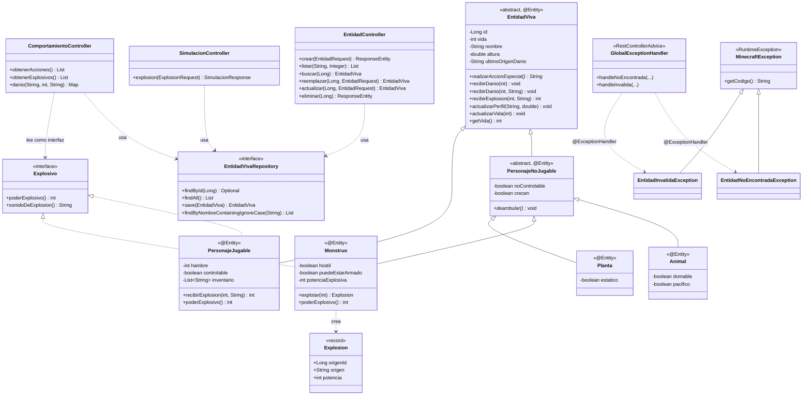

# POO-08 — Minecraft, explosiones y persistencia en H2

Servicio HTTP con Spring Boot sobre el dominio **Minecraft**. Persiste una familia de entidades en **H2**, expone un **CRUD REST** completo, una **simulación de explosiones** con dos reglas de negocio, una **interfaz de dominio** y una **jerarquía de excepciones** con un handler HTTP por tipo.

- **Alumno:** Adrian (GitHub: `Adrian-312`)
- **Asignatura:** Lenguaje de Programación 3 (CYT646)
- **Ejercicio:** POO-08 — CRUD REST, H2, reglas de juego y excepciones
- **Commit de la solución:** pendiente de registrar después del commit final (ver la entrega en Classroom).
- **Colección Insomnia:** [`insomnia/poo08-minecraft.json`](insomnia/poo08-minecraft.json)
- **Especificaciones aplicadas al dominio:** [`docs/ESPECIFICACIONES-POO08.md`](docs/ESPECIFICACIONES-POO08.md)
- **Bitácora de IA:** [`BITACORA.md`](BITACORA.md)

---

## 1. Cómo arrancar

Requisitos: **Java JDK 21** y conexión a Maven la primera vez (el wrapper descarga las dependencias).

```bash
./mvnw spring-boot:run
```

El servicio queda en `http://localhost:8080`.

| URL | Qué hace |
|---|---|
| `GET /` | Confirma que la aplicación vive y lista los endpoints. |
| `GET /h2-console` | Consola web de H2 para ver las tablas. |
| `GET /minecraft/entidades` | Lista lo que está persistido. |
| `POST /minecraft/entidades` | Crea una entidad. |
| `GET /minecraft/entidades/{id}` | Lee una entidad o devuelve 404. |
| `PUT /minecraft/entidades/{id}` | Reemplaza los campos editables. |
| `PATCH /minecraft/entidades/{id}` | Actualiza solo los campos enviados. |
| `DELETE /minecraft/entidades/{id}` | Borra la fila y devuelve 204. |
| `GET /minecraft/explosivos` | Lee con la interfaz `Explosivo`. |
| `POST /minecraft/simulacion/explosion` | Ejecuta la simulación persistida. |
| `GET /minecraft/acciones` | Polimorfismo con el método abstracto `realizarAccionEspecial()`. |

Para reiniciar la base desde cero: detener la aplicación, borrar la carpeta `data/` y volver a arrancar. La carpeta `data/` está en `.gitignore` porque es estado local de H2.

---

## 2. Propiedades de H2 explicadas

Archivo: `src/main/resources/application.properties`.

| Propiedad | Qué significa |
|---|---|
| `spring.datasource.url=jdbc:h2:file:./data/minecraft;AUTO_SERVER=TRUE` | H2 guarda la base en el archivo `./data/minecraft.mv.db`. `AUTO_SERVER=TRUE` permite que otro proceso (por ejemplo la consola) se conecte al mismo archivo. |
| `spring.datasource.username=sa` | Usuario por defecto de H2. |
| `spring.datasource.password=` | Sin contraseña, como corresponde al perfil de desarrollo del taller. |
| `spring.datasource.driver-class-name=org.h2.Driver` | Driver JDBC de H2. |
| `spring.jpa.hibernate.ddl-auto=update` | Hibernate crea las tablas si no existen y las actualiza si cambia una entidad. No borra datos en cada arranque. |
| `spring.jpa.show-sql=true` | Muestra en consola el SQL que genera Hibernate. |
| `spring.jpa.properties.hibernate.format_sql=true` | Formatea ese SQL para que sea legible. |
| `spring.jpa.open-in-view=false` | Cierra la sesión de JPA al terminar la petición; el controller no depende de una sesión abierta para serializar. |
| `spring.h2.console.enabled=true` | Habilita la consola web de H2. |
| `spring.h2.console.path=/h2-console` | URL donde se abre la consola. |

**Consola H2:** abrir `http://localhost:8080/h2-console`, usar:

- JDBC URL: `jdbc:h2:file:./data/minecraft`
- User: `sa`
- Password: vacío

Tablas principales: `entidad_viva` (herencia en una sola tabla) y `jugador_inventario` (elementos del inventario).

---

## 3. Diagrama Mermaid



Cómo se lee el diagrama:

- **Herencia:** `EntidadViva` es la clase base persistida. `PersonajeJugable` y `PersonajeNoJugable` son sus hijas; de `PersonajeNoJugable` cuelgan `Animal`, `Monstruo` y `Planta`. El método abstracto `realizarAccionEspecial()` se sobreescribe en cada clase concreta.
- **Implementación de interfaz:** `PersonajeJugable` y `Monstruo` pertenecen a ramas distintas, pero ambos implementan `Explosivo`. El endpoint `GET /minecraft/explosivos` los trata como `List<Explosivo>`.
- **Uso del repositorio:** los controllers dependen de la interfaz `EntidadVivaRepository`. Spring Data genera la implementación en tiempo de arranque; no hay una clase escrita a mano que consulte la base.
- **Jerarquía de excepciones:** `MinecraftException` es la base; `EntidadNoEncontradaException` y `EntidadInvalidaException` son las hijas. `GlobalExceptionHandler` tiene un método distinto para cada una.

---

## 4. Modelo persistido y herencia JPA

Se persisten las **tres clases que la simulación necesita** dentro de la misma familia:

| Clase | Rol en la simulación |
|---|---|
| `PersonajeJugable` | Recibe la onda expansiva y puede consumir escudos del inventario. |
| `Monstruo` | El Creeper que explota y muere; otros monstruos reciben daño. |
| `Animal` | Entidad cercana que recibe el daño completo, sin escudos. |

Además se mapean `EntidadViva` (padre), `PersonajeNoJugable` (intermedia abstracta) y `Planta`, porque comparten la misma familia. La estrategia elegida es **`InheritanceType.SINGLE_TABLE`** con la columna discriminadora `tipo_entidad`. Es la más simple para este modelo: una sola tabla `entidad_viva`, sin joins para leer el estado del mundo, y el subtipo se distingue por el discriminador.

El JSON de salida agrega el campo `tipo` mediante `@JsonTypeInfo` y `@JsonSubTypes` sobre `EntidadViva`. En la entrada, el DTO `EntidadRequest` lee ese campo y el controller elige el constructor de negocio. No se deserializa directamente una entidad JPA: así Jackson no puede saltarse los constructores validados ni dejar el objeto en un estado imposible.

**Constructor vacío de JPA:** cada entidad tiene un constructor sin argumentos con visibilidad `protected`. JPA lo usa para reconstruir filas, pero el resto del código no puede crear una entidad sin pasar por los constructores de negocio que validan nombre, vida, altura, hambre, potencia, etc.

---

## 5. Las dos reglas del juego

1. **Onda expansiva:** cuando un `Monstruo` explosivo (Creeper) ejecuta `explotar(potencia)`, pierde toda su vida y todas las entidades vivas del mundo reciben `potencia` puntos de daño, sin bajar de cero.
2. **Escudos de bloque:** antes de aplicar la onda, cada `PersonajeJugable` consume un `"escudo"` de su inventario y cada escudo absorbe 5 puntos de daño; si no le quedan escudos, recibe el resto completo.

Las dos reglas viven en el dominio:

- `Monstruo.explotar(int)` valida que el monstruo esté vivo, sea hostil y que la potencia no supere su `potenciaExplosiva`.
- `EntidadViva.recibirExplosion(int, String)` aplica el daño base.
- `PersonajeJugable.recibirExplosion(int, String)` sobreescribe el método para consumir escudos y reducir el daño.

La simulación se dispara con `POST /minecraft/simulacion/explosion`, guarda todos los cambios con `repository.saveAll(...)` y un `GET /minecraft/entidades` posterior muestra la vida y los inventarios modificados. Participan `Monstruo`, `PersonajeJugable` y `Animal`.

---

## 6. Respuestas a “Qué hay que pensar”

**¿Cuál es el sustantivo de la API?**  
`entidades`. Las URLs nombran el recurso (`/minecraft/entidades`, `/minecraft/entidades/{id}`) y el verbo HTTP dice la operación (`GET`, `POST`, `PUT`, `PATCH`, `DELETE`).

**¿Qué campo es la clave y quién la asigna?**  
La clave es `id`, un `Long` generado por JPA con `@GeneratedValue(strategy = GenerationType.IDENTITY)`. El JSON de creación **no** lleva `id`: lo asigna la base y se devuelve en la respuesta `201 Created` con la cabecera `Location`.

**¿Cómo se guarda la jerarquía y cómo se distingue el subtipo?**  
Con `SINGLE_TABLE`: una tabla `entidad_viva` y una columna `tipo_entidad` que guarda `jugador`, `monstruo`, `animal` o `planta`. En el JSON, `@JsonTypeInfo` agrega el campo `tipo` al listar y `@JsonSubTypes` permite reconocer cada subtipo.

**¿Qué gana el controller al depender del repositorio como interfaz?**  
El controller no conoce ninguna implementación concreta. Declara `EntidadVivaRepository` y Spring Data genera los métodos en tiempo de arranque. Es el mismo beneficio del protocolo de POO-07: el que usa el tipo no queda atado a una clase concreta.

**¿Qué endpoint usa la interfaz del dominio?**  
`GET /minecraft/explosivos`. El controller arma una `List<Explosivo>` con las entidades persistidas que implementan la interfaz y pide `poderExplosivo()` y `sonidoDeExplosion()`. `PersonajeJugable` y `Monstruo` son de familias distintas y responden por el mismo tipo.

**¿Quién sostiene las reglas numéricas y cómo se prueba el ocultamiento?**  
Las clases del dominio: constructores y métodos como `explotar`, `recibirExplosion`, `recibirDanio` y `actualizarVida` validan los valores. No hay setters públicos. Un `POST` ilegal (por ejemplo, nombre vacío o vida negativa) lanza una excepción antes de llegar a `repository.save(...)`, así que la tabla no crece con basura. En Insomnia está el pedido “POST ilegal”.

**¿PUT y PATCH reemplazan todo o solo un subconjunto?**  
`PUT` reemplaza los campos editables: si se omite un campo opcional, vuelve a su valor por defecto del dominio. `PATCH` cambia solo los campos que vienen en el JSON y conserva los omitidos. El `id` y el subtipo (`tipo`) no se pueden cambiar; un `tipo` distinto devuelve `400`.

**¿Qué significa borrar en este modelo?**  
`DELETE` elimina la fila de la entidad en H2 y responde `204 No Content`. Si el `id` no existe, responde `404`. Borrar una entidad la saca del mundo persistido; no es un mensaje del dominio, es una operación de persistencia.

**¿Qué dos hechos del juego cambian el estado de más de un objeto?**  
La onda expansiva cambia la vida de todas las entidades vivas y el escudo cambia la vida y el inventario de cada jugador que lo lleva. El recurso HTTP de la simulación es `POST /minecraft/simulacion/explosion`. Un `GET /minecraft/entidades` posterior muestra el resultado ya persistido.

**¿Cómo se llaman las excepciones y por qué son dos tipos distintos?**  
`EntidadNoEncontradaException` (recurso inexistente, HTTP 404) y `EntidadInvalidaException` (regla o invariante incumplido, HTTP 400). Son hermanas de `MinecraftException`. Son **no comprobadas** (`RuntimeException`): el dominio puede lanzarlas sin obligar a cada método intermedio a declararlas, y el `@RestControllerAdvice` las traduce a HTTP. El JSON de error lleva `timestamp`, `status`, `codigo`, `mensaje` y `path`.

---

## 7. Sobrecarga y sobreescritura

**Sobrecarga** (misma clase, mismo nombre, distinta lista de argumentos):

- Constructores simples y completos en `EntidadViva`, `PersonajeNoJugable`, `PersonajeJugable`, `Animal`, `Monstruo` y `Planta`.
- `EntidadViva.recibirDanio(int)` y `EntidadViva.recibirDanio(int, String)`: la segunda variante registra el origen del daño.
- `Monstruo` tiene un constructor completo de 6 parámetros y otro de 7 que agrega `potenciaExplosiva`.

**Sobreescritura** (misma firma entre padre e hija, implementación distinta):

- `EntidadViva.realizarAccionEspecial()` es abstracto y lo implementan `PersonajeJugable`, `Animal`, `Monstruo` y `Planta`.
- `PersonajeNoJugable.deambular()` es abstracto y lo sobreescriben `Animal`, `Monstruo` y `Planta`.
- `PersonajeJugable.recibirExplosion(int, String)` sobreescribe el método de `EntidadViva` para consumir escudos.
- `Explosivo.poderExplosivo()` lo implementan `PersonajeJugable` y `Monstruo`, cada uno con su propia fórmula.

**Cómo se distinguen:** la sobrecarga ocurre dentro de una misma clase y cambia la lista de argumentos; la sobreescritura ocurre entre padre e hija (o entre interfaz e implementación) y mantiene la misma firma.

---

## 8. Endpoints y ejemplos

### Crear un jugador

```bash
curl -i -X POST http://localhost:8080/minecraft/entidades \
  -H 'Content-Type: application/json' \
  -d '{"tipo":"jugador","nombre":"Steve","vida":20,"altura":1.8,"hambre":20,"controlable":true,"inventario":["escudo","escudo","TNT"]}'
```

Respuesta `201 Created` con `Location: /minecraft/entidades/1` y el JSON con `id`, `tipo`, `vida`, `inventario`, etc.

### Crear un animal y un monstruo

```bash
curl -X POST http://localhost:8080/minecraft/entidades \
  -H 'Content-Type: application/json' \
  -d '{"tipo":"animal","nombre":"Vaca","vida":20,"altura":1.1,"domable":true,"pacifico":true}'

curl -X POST http://localhost:8080/minecraft/entidades \
  -H 'Content-Type: application/json' \
  -d '{"tipo":"monstruo","nombre":"Creeper","vida":20,"hostil":true,"potenciaExplosiva":10}'
```

### Actualizar

```bash
curl -X PUT http://localhost:8080/minecraft/entidades/1 \
  -H 'Content-Type: application/json' \
  -d '{"tipo":"jugador","nombre":"Steve","vida":20,"altura":1.9,"hambre":15,"inventario":["escudo","escudo"]}'

curl -X PATCH http://localhost:8080/minecraft/entidades/1 \
  -H 'Content-Type: application/json' \
  -d '{"hambre":18}'
```

### Simular la explosión

```bash
curl -X POST http://localhost:8080/minecraft/simulacion/explosion \
  -H 'Content-Type: application/json' \
  -d '{"monstruoId":3,"potencia":10}'

curl http://localhost:8080/minecraft/entidades
```

La respuesta de la simulación incluye `escudosConsumidos` y, por cada entidad afectada, `vidaAntes`, `vidaDespues`, `escudosConsumidos` y `vivo`.

### Borrar

```bash
curl -i -X DELETE http://localhost:8080/minecraft/entidades/2
curl -i http://localhost:8080/minecraft/entidades/2   # 404
```

### Errores

```bash
# 400 ENTIDAD_INVALIDA
curl -i -X POST http://localhost:8080/minecraft/entidades \
  -H 'Content-Type: application/json' \
  -d '{"tipo":"jugador","nombre":"","vida":-5}'

# 404 ENTIDAD_NO_ENCONTRADA
curl -i http://localhost:8080/minecraft/entidades/999

# 400 ENTIDAD_INVALIDA: potencia mayor que la del monstruo
curl -i -X POST http://localhost:8080/minecraft/simulacion/explosion \
  -H 'Content-Type: application/json' \
  -d '{"monstruoId":4,"potencia":11}'
```

---

## 9. Colección de Insomnia

Archivo: [`insomnia/poo08-minecraft.json`](insomnia/poo08-minecraft.json).

**Cómo importar:**

1. Abrir Insomnia.
2. `Import` → `From File` → elegir `insomnia/poo08-minecraft.json`.
3. Seleccionar el workspace **POO-08 Minecraft - Explosiones H2**.
4. Activar el entorno **Base Environment**.
5. Verificar `base_url` (por defecto `http://localhost:8080`).

**Orden sugerido:**

1. `GET /` para confirmar que el servicio está vivo.
2. Crear los dos jugadores (`Steve` con escudos y `Alex` sin escudo).
3. Crear `Vaca`, `Creeper` y `Creeper2`.
4. Copiar los `id` devueltos en las variables del entorno: `jugador_id`, `jugador2_id`, `animal_id`, `creeper_id`, `creeper2_id`. Los valores por defecto son 1 a 5 si la base está vacía.
5. `GET /minecraft/entidades`, `GET` por id, `PUT` y `PATCH`.
6. `GET /minecraft/explosivos` para ver la interfaz.
7. `POST /minecraft/simulacion/explosion` con `creeper_id` y potencia 10.
8. `GET /minecraft/entidades` para comprobar el estado persistido después de simular.
9. Ejecutar los pedidos de error: POST ilegal, id inexistente, potencia inválida, monstruo inexistente, DELETE y GET posterior.
10. Abrir `http://localhost:8080/h2-console` y ver la tabla `entidad_viva`.

**Variables del entorno:**

| Variable | Uso | Valor por defecto |
|---|---|---|
| `base_url` | URL del servicio | `http://localhost:8080` |
| `jugador_id` | Steve | `1` |
| `jugador2_id` | Alex | `2` |
| `animal_id` | Vaca | `3` |
| `creeper_id` | Creeper que explota | `4` |
| `creeper2_id` | Creeper para el error de potencia | `5` |

Si la base ya tenía datos, actualizar los valores después de cada `POST` con el `id` real de la respuesta.

---

## 10. Estructura de paquetes

```text
src/main/java/py/edu/uc/lp3/avera_tplp3_2026/
├── AveraTplp32026Application.java
├── domain/
│   ├── Animal.java
│   ├── EntidadViva.java
│   ├── Explosion.java
│   ├── Explosivo.java
│   ├── Monstruo.java
│   ├── PersonajeJugable.java
│   ├── PersonajeNoJugable.java
│   ├── Planta.java
│   └── exception/
│       ├── EntidadInvalidaException.java
│       ├── EntidadNoEncontradaException.java
│       └── MinecraftException.java
├── repository/
│   └── EntidadVivaRepository.java
└── rest/
    ├── controller/
    │   ├── ComportamientoController.java
    │   ├── ConstruccionController.java
    │   ├── EntidadController.java
    │   ├── IndexController.java
    │   └── SimulacionController.java
    ├── dto/
    │   ├── EntidadRequest.java
    │   ├── ErrorResponse.java
    │   ├── ExplosionRequest.java
    │   └── SimulacionResponse.java
    └── exception/
        └── GlobalExceptionHandler.java
```

Las reglas del juego viven en `domain`; el repositorio solo traduce filas; los controllers traducen HTTP; el handler traduce excepciones a JSON.

---

## 11. Verificación rápida

```bash
./mvnw test
```

Las pruebas de `SimulacionDomainTest` verifican que el Creeper muere al explotar, que los escudos absorben 5 puntos cada uno y se consumen, que un animal recibe el daño completo y que una potencia inválida lanza `EntidadInvalidaException`.

Checklist de la rúbrica:

- [x] Servicio que arranca con `./mvnw spring-boot:run`.
- [x] Persistencia real en H2 con `ddl-auto=update`.
- [x] Familia `EntidadViva` con `PersonajeJugable`, `Monstruo` y `Animal` persistidos.
- [x] CRUD completo sobre `/minecraft/entidades`.
- [x] Interfaz `Explosivo` usada por un endpoint de lectura.
- [x] Dos reglas de explosión en el dominio.
- [x] Simulación persistida con `GET` posterior.
- [x] Jerarquía de excepciones con un handler por tipo.
- [x] Colección Insomnia con CRUD, simulación y errores.
- [x] README, bitácora y documento de especificaciones.
