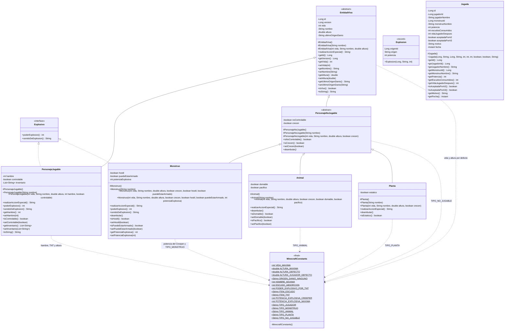

# Minecraft - Servicio REST con Spring Boot y H2 (POO-08 / POO-09)

Servicio HTTP sobre el modelado de **Minecraft**. Guarda su estado en una base **H2**, expone un CRUD REST sobre las entidades vivas del juego y simula **explosiones** que cambian el estado de varios objetos a la vez. En POO-09 se agregó un escenario que consulta a los compañeros A2 y A3 antes de persistir la jugada.

- Autor: Adrian Vera
- Asignatura: Lenguaje de Programación 3 (CYT646)
- Entrega POO-09: [documento aplicado](docs/POO09-APLICADO.md) · commit de la solución: `https://github.com/Adrian-312/avera-tplp3-2026/commit/<HASH_DEL_COMMIT>` 

## Cómo arrancar

```bash
./mvnw spring-boot:run        # Linux / macOS / Git Bash
mvnw.cmd spring-boot:run      # Windows (CMD o PowerShell)
```

El servicio (A1) queda en <http://localhost:8080/> y la consola de la base en <http://localhost:8080/h2-console>. El OpenAPI propio está en <http://localhost:8080/v3/api-docs> y Swagger UI en <http://localhost:8080/swagger-ui.html>. Las instrucciones completas de ejecución, prueba y solución de problemas están en [`RUN.md`](RUN.md). Para el challenge POO-09, A2 escucha en `8081` y A3 en `8082`: conviene arrancar primero esos dos servicios y recién después A1, como se detalla en [«Cómo arrancar los tres servicios»](#cómo-arrancar-los-tres-servicios).

## Propiedades de H2 (`application.properties`)

| Propiedad | Qué hace |
|---|---|
| `spring.application.name` | Nombre de la aplicación. |
| `spring.datasource.url=jdbc:h2:file:./data/minecraft;AUTO_SERVER=TRUE` | Guarda la base en un archivo dentro de `./data`, por lo que el estado sobrevive a un reinicio. `AUTO_SERVER=TRUE` permite abrirla desde otro proceso mientras el servicio corre. |
| `spring.datasource.username` / `password` | Credenciales de H2: usuario `sa` y contraseña vacía (valores por defecto de desarrollo). |
| `spring.datasource.driver-class-name=org.h2.Driver` | Driver JDBC con el que Java habla con H2. |
| `spring.jpa.hibernate.ddl-auto=update` | Hibernate crea o ajusta las tablas a partir de las anotaciones de las entidades, sin borrar datos. |
| `spring.jpa.show-sql=true` | Muestra en la consola el SQL que se ejecuta. |
| `spring.jpa.properties.hibernate.format_sql=true` | Imprime ese SQL con formato legible. |
| `spring.jpa.open-in-view=false` | La sesión de base de datos no queda abierta durante toda la petición HTTP: el acceso a datos queda en el repositorio y las transacciones. |
| `spring.h2.console.enabled=true` | Habilita la consola web de H2 (solo para desarrollo). |
| `spring.h2.console.path=/h2-console` | URL de esa consola. |

## Endpoints

| Verbo y URL | Qué hace | Éxito |
|---|---|---|
| `GET /` | Confirma que el servicio vive y enlaza su OpenAPI y Swagger UI | 200 |
| `POST /minecraft/entidades` | Crea una entidad (`tipo`: jugador, monstruo, animal o planta) | 201 |
| `GET /minecraft/entidades` | Lista; filtros opcionales `nombre` y `vidaMinima` | 200 |
| `GET /minecraft/entidades/{id}` | Devuelve una entidad | 200 |
| `PUT /minecraft/entidades/{id}` | Reemplaza la entidad completa | 200 |
| `PATCH /minecraft/entidades/{id}` | Cambia solo los campos enviados | 200 |
| `DELETE /minecraft/entidades/{id}` | Elimina la entidad | 204 |
| `GET /minecraft/explosivos` | Todo lo que implementa la interface `Explosivo` | 200 |
| `GET /minecraft/acciones` | Acción especial de cada entidad (polimorfismo) | 200 |
| `POST /minecraft/simulacion/explosion` | Simula la explosión de un monstruo | 200 |
| `POST /minecraft/reglas/condicion-previa` | Regla publicada: jugador y monstruo existen, tienen el tipo correcto y están vivos | 200 |
| `POST /minecraft/reglas/absorcion-escudo` | Regla publicada: cada escudo absorbe 5 puntos y devuelve `vidaDespues` | 200 |
| `POST /minecraft/escenarios/explosion-validada` | Consulta A2 y A3, simula y guarda la jugada | 201 |
| `GET /minecraft/escenarios` | Lista el historial de jugadas | 200 |
| `GET /v3/api-docs` / `GET /swagger-ui.html` | Documentación OpenAPI generada | 200 |

Errores (JSON con `timestamp`, `status`, `codigo`, `mensaje` y `path`):

| Excepción | Código HTTP | `codigo` |
|---|---|---|
| `EntidadNoEncontradaException` | 404 | `ENTIDAD_NO_ENCONTRADA` |
| `EntidadInvalidaException` | 400 | `ENTIDAD_INVALIDA` |
| `EntidadMuertaException` (`PUT`/`PATCH` sobre entidad muerta) | 409 | `ENTIDAD_MUERTA` |
| `ReglaRechazadaException` (condición previa inválida o daño declarado distinto del calculado) | 400 | `REGLA_RECHAZADA` |
| JSON ilegible (Spring) | 400 | `CUERPO_ILEGIBLE` |
| Parámetro con tipo inválido (por ejemplo `/minecraft/entidades/abc`) | 400 | `PARAMETRO_INVALIDO` |
| Rechazo de A2 / A3 | 400 | `RECHAZO_A2` / `RECHAZO_A3` |
| Fallo al consultar A2 / A3 | 502 | `FALLO_A2` / `FALLO_A3` |

## Diagrama

El diagrama se divide en cuatro capas para que sea legible: dominio, excepciones, servicios con persistencia e integración, y capa REST con DTOs y configuración. Las clases marcadas como `externa` solo anclan las relaciones con otra capa. `+`, `-` y `#` indican visibilidad pública, privada y protegida; `$` marca miembros estáticos y `*` miembros abstractos.

### 1. Dominio (`domain` y `constants`)



### 2. Excepciones y manejo de errores (`exception`)

```mermaid
classDiagram
    direction TB

    class RuntimeException {
        <<java.lang>>
    }

    class IllegalArgumentException {
        <<java.lang>>
    }

    class MethodArgumentTypeMismatchException {
        <<spring>>
    }

    class HttpMessageNotReadableException {
        <<spring>>
    }

    class MinecraftException {
        -String codigo
        #MinecraftException(String codigo, String mensaje)
        #MinecraftException(String codigo, String mensaje, Throwable causa)
        +getCodigo() String
    }

    class EntidadNoEncontradaException {
        +EntidadNoEncontradaException(String mensaje)
    }

    class EntidadInvalidaException {
        +EntidadInvalidaException(String mensaje)
    }

    class EntidadMuertaException {
        +EntidadMuertaException(String mensaje)
    }

    class ReglaRechazadaException {
        +ReglaRechazadaException(String mensaje)
    }

    class IntegracionExternaException {
        -String companero
        +IntegracionExternaException(String companero, String mensaje)
        +getCompanero() String
    }

    class RechazoExternoException {
        -int statusExterno
        -String codigoExterno
        +RechazoExternoException(String companero, int statusExterno, String codigoExterno, String motivo)
        +getStatusExterno() int
        +getCodigoExterno() String
    }

    class GlobalExceptionHandler {
        <<RestControllerAdvice>>
        +handleNoEncontrada(EntidadNoEncontradaException, HttpServletRequest) ResponseEntity~ErrorResponse~
        +handleInvalida(EntidadInvalidaException, HttpServletRequest) ResponseEntity~ErrorResponse~
        +handleMuerta(EntidadMuertaException, HttpServletRequest) ResponseEntity~ErrorResponse~
        +handleReglaRechazada(ReglaRechazadaException, HttpServletRequest) ResponseEntity~ErrorResponse~
        +handleRechazoExterno(RechazoExternoException, HttpServletRequest) ResponseEntity~ErrorResponse~
        +handleFalloExterno(IntegracionExternaException, HttpServletRequest) ResponseEntity~ErrorResponse~
        +handleBase(MinecraftException, HttpServletRequest) ResponseEntity~ErrorResponse~
        +handleIllegalArgument(IllegalArgumentException, HttpServletRequest) ResponseEntity~ErrorResponse~
        +handleTipoInvalido(MethodArgumentTypeMismatchException, HttpServletRequest) ResponseEntity~ErrorResponse~
        +handleJsonIlegible(HttpMessageNotReadableException, HttpServletRequest) ResponseEntity~ErrorResponse~
        -respuesta(HttpStatus, MinecraftException, HttpServletRequest) ResponseEntity~ErrorResponse~
    }

    class ErrorResponse {
        <<record>>
        String timestamp
        int status
        String codigo
        String mensaje
        String path
        +ErrorResponse(String, int, String, String, String)
    }

    RuntimeException <|-- MinecraftException
    RuntimeException <|-- IntegracionExternaException
    MinecraftException <|-- EntidadNoEncontradaException
    MinecraftException <|-- EntidadInvalidaException
    MinecraftException <|-- EntidadMuertaException
    MinecraftException <|-- ReglaRechazadaException
    IntegracionExternaException <|-- RechazoExternoException

    GlobalExceptionHandler ..> MinecraftException : traduce a HTTP
    GlobalExceptionHandler ..> EntidadNoEncontradaException : 404 ENTIDAD_NO_ENCONTRADA
    GlobalExceptionHandler ..> EntidadInvalidaException : 400 ENTIDAD_INVALIDA
    GlobalExceptionHandler ..> EntidadMuertaException : 409 ENTIDAD_MUERTA
    GlobalExceptionHandler ..> ReglaRechazadaException : 400 REGLA_RECHAZADA
    GlobalExceptionHandler ..> RechazoExternoException : 400 RECHAZO_*
    GlobalExceptionHandler ..> IntegracionExternaException : 502 FALLO_*
    GlobalExceptionHandler ..> IllegalArgumentException : 400 ARGUMENTO_INVALIDO
    GlobalExceptionHandler ..> MethodArgumentTypeMismatchException : 400 PARAMETRO_INVALIDO
    GlobalExceptionHandler ..> HttpMessageNotReadableException : 400 CUERPO_ILEGIBLE
    GlobalExceptionHandler ..> ErrorResponse : devuelve
```



### 3. Servicios, repositorios e integración (`service`, `service.impl`, `repository`, `integration`)

```mermaid
classDiagram
    direction LR

    class JpaRepository {
        <<interface>>
    }
    class EntidadVivaRepository {
        <<interface>>
        +findByNombreContainingIgnoreCase(String) List~EntidadViva~
        +findByVidaGreaterThanEqual(int) List~EntidadViva~
        +findByNombreContainingIgnoreCaseAndVidaGreaterThanEqual(String, int) List~EntidadViva~
    }
    class JugadaRepository {
        <<interface>>
    }

    class EntidadService {
        <<interface>>
        +crear(EntidadRequest) EntidadViva
        +listar(String, Integer) List~EntidadViva~
        +buscar(Long) EntidadViva
        +reemplazar(Long, EntidadRequest) EntidadViva
        +actualizar(Long, EntidadRequest) EntidadViva
        +eliminar(Long)
    }
    class SimulacionService {
        <<interface>>
        +simularExplosion(Long, Integer) SimulacionResponse
    }
    class ComportamientoService {
        <<interface>>
        +obtenerAcciones() List~Map~String, String~~
        +obtenerExplosivos() List~Map~String, Object~~
    }
    class EscenarioService {
        <<interface>>
        +ejecutar(EscenarioRequest) EscenarioResponse
        +listar() List~Jugada~
    }
    class CondicionPreviaService {
        <<interface>>
        +validar(Long, Long) Participantes
    }
    class ReglaService {
        <<interface>>
        +validarCondicionPrevia(CondicionPreviaRequest) VeredictoRegla
        +absorcionEscudo(AbsorcionEscudoRequest) VeredictoRegla
    }
    class Participantes {
        <<record anidado en CondicionPreviaService>>
        PersonajeJugable jugador
        Monstruo monstruo
        +Participantes(PersonajeJugable, Monstruo)
    }

    class EntidadServiceImpl {
        <<Service>>
        -EntidadVivaRepository repository
        +EntidadServiceImpl(EntidadVivaRepository)
        +crear(EntidadRequest) EntidadViva
        +listar(String, Integer) List~EntidadViva~
        +buscar(Long) EntidadViva
        +reemplazar(Long, EntidadRequest) EntidadViva
        +actualizar(Long, EntidadRequest) EntidadViva
        +eliminar(Long)
        -obtener(Long) EntidadViva
        -construir(EntidadRequest) EntidadViva
        -rechazarSiEstaMuerta(EntidadViva)
        -aplicarCambios(EntidadViva, EntidadRequest, boolean)
        -cambiarJugador(PersonajeJugable, EntidadRequest, boolean)
        -cambiarMonstruo(Monstruo, EntidadRequest, boolean)
        -cambiarAnimal(Animal, EntidadRequest, boolean)
        -cambiarPlanta(Planta, EntidadRequest, boolean)
        -actualizarPerfil(EntidadViva, String, double)
        -actualizarVida(EntidadViva, int)
        -validarBase(String, int, double)
        -validarNombre(String)
        -validarVida(int)
        -validarAltura(double)
        -validarHambre(int)
        -validarPotencia(int)
        -normalizarInventario(List~String~) List~String~
        -normalizarTipo(String) String
        -tipoDe(EntidadViva) String
        -alturaPorDefecto(EntidadViva) double
    }

    class SimulacionServiceImpl {
        <<Service>>
        -EntidadVivaRepository repository
        +SimulacionServiceImpl(EntidadVivaRepository)
        +simularExplosion(Long, Integer) SimulacionResponse
        -explotar(Monstruo, int) Explosion
        -validarExplosion(String, int)
        -recibirExplosion(EntidadViva, int, String) int
        -consumirItem(PersonajeJugable, String) boolean
        -aplicarDanio(EntidadViva, int, String)
    }

    class ComportamientoServiceImpl {
        <<Service>>
        -EntidadVivaRepository repository
        +ComportamientoServiceImpl(EntidadVivaRepository)
        +obtenerAcciones() List~Map~String, String~~
        +obtenerExplosivos() List~Map~String, Object~~
    }

    class EscenarioServiceImpl {
        <<Service>>
        -JugadaRepository jugadaRepository
        -SimulacionService simulacionService
        -ReglaExternaClient reglaExternaClient
        -CondicionPreviaService condicionPreviaService
        +EscenarioServiceImpl(JugadaRepository, SimulacionService, ReglaExternaClient, CondicionPreviaService)
        +ejecutar(EscenarioRequest) EscenarioResponse
        +listar() List~Jugada~
        -limpiarPrefijo(String, String) String
    }

    class CondicionPreviaServiceImpl {
        <<Service>>
        -EntidadVivaRepository repository
        +CondicionPreviaServiceImpl(EntidadVivaRepository)
        +validar(Long, Long) Participantes
    }
    class ReglaServiceImpl {
        <<Service>>
        -CondicionPreviaService condicionPreviaService
        +ReglaServiceImpl(CondicionPreviaService)
        +validarCondicionPrevia(CondicionPreviaRequest) VeredictoRegla
        +absorcionEscudo(AbsorcionEscudoRequest) VeredictoRegla
    }

    class Companero {
        <<enumeration>>
        A2
        A3
    }

    class ReglaExternaClient {
        <<Component>>
        -Logger LOG$
        -String REGLA_A3$
        -Map~Companero, WebClient~ clientes
        -Map~Companero, String~ baseUrls
        -Map~Companero, String~ rutas
        -Duration timeout
        -ObjectMapper objectMapper
        +ReglaExternaClient(WebClient~Builder~, ObjectMapper, String, String, String, String, long)
        +validar(Companero, ValidacionExternaRequest) ValidacionExternaResponse
        -cuerpoPara(Companero, ValidacionExternaRequest) Map~String, Object~
        -leerJson(Companero, String) JsonNode
        -lanzarRechazo(Companero, int, JsonNode) void
        -decision(Companero, int, JsonNode) ValidacionExternaResponse
        -textoRequerido(Companero, JsonNode, String) String
        -numeroRequerido(Companero, JsonNode, String) double
        -enteroRequerido(Companero, JsonNode, String) int
    }

    class RespuestaCruda {
        <<record anidado en ReglaExternaClient>>
        int status
        String cuerpo
        +RespuestaCruda(int, String)
    }

    class EntidadViva {
        <<externa: domain>>
    }
    class PersonajeJugable {
        <<externa: domain>>
    }
    class Monstruo {
        <<externa: domain>>
    }
    class Animal {
        <<externa: domain>>
    }
    class Planta {
        <<externa: domain>>
    }
    class Explosion {
        <<externa: domain>>
    }
    class Explosivo {
        <<externa: domain>>
    }
    class Jugada {
        <<externa: domain>>
    }
    class EntidadRequest {
        <<externa: rest.dto>>
    }
    class EscenarioRequest {
        <<externa: rest.dto>>
    }
    class EscenarioResponse {
        <<externa: rest.dto>>
    }
    class SimulacionResponse {
        <<externa: rest.dto>>
    }
    class ValidacionExternaRequest {
        <<externa: rest.dto>>
    }
    class ValidacionExternaResponse {
        <<externa: rest.dto>>
    }
    class CondicionPreviaRequest {
        <<externa: rest.dto>>
    }
    class AbsorcionEscudoRequest {
        <<externa: rest.dto>>
    }
    class VeredictoRegla {
        <<externa: rest.dto>>
    }
    class ResultadoEntidad {
        <<externa: rest.dto>>
    }
    class MinecraftConstants {
        <<externa: constants>>
    }
    class EntidadInvalidaException {
        <<externa: exception>>
    }
    class EntidadNoEncontradaException {
        <<externa: exception>>
    }
    class EntidadMuertaException {
        <<externa: exception>>
    }
    class ReglaRechazadaException {
        <<externa: exception>>
    }
    class RechazoExternoException {
        <<externa: exception>>
    }
    class IntegracionExternaException {
        <<externa: exception>>
    }

    JpaRepository <|-- EntidadVivaRepository : EntidadViva, Long
    JpaRepository <|-- JugadaRepository : Jugada, Long
    EntidadVivaRepository ..> EntidadViva : persiste
    JugadaRepository ..> Jugada : persiste

    EntidadService <|.. EntidadServiceImpl
    SimulacionService <|.. SimulacionServiceImpl
    ComportamientoService <|.. ComportamientoServiceImpl
    EscenarioService <|.. EscenarioServiceImpl
    CondicionPreviaService <|.. CondicionPreviaServiceImpl
    ReglaService <|.. ReglaServiceImpl

    EntidadServiceImpl --> EntidadVivaRepository
    SimulacionServiceImpl --> EntidadVivaRepository
    ComportamientoServiceImpl --> EntidadVivaRepository
    CondicionPreviaServiceImpl --> EntidadVivaRepository
    CondicionPreviaService ..> Participantes : devuelve
    CondicionPreviaServiceImpl *-- Participantes : construye
    EscenarioServiceImpl --> JugadaRepository
    EscenarioServiceImpl --> SimulacionService
    EscenarioServiceImpl --> ReglaExternaClient
    EscenarioServiceImpl --> CondicionPreviaService
    ReglaServiceImpl --> CondicionPreviaService
    ReglaExternaClient --> Companero : claves de los mapas
    ReglaExternaClient *-- RespuestaCruda : crea

    EntidadServiceImpl ..> EntidadRequest : recibe
    EntidadServiceImpl ..> PersonajeJugable : construye
    EntidadServiceImpl ..> Monstruo : construye
    EntidadServiceImpl ..> Animal : construye
    EntidadServiceImpl ..> Planta : construye
    EntidadServiceImpl ..> EntidadInvalidaException : lanza
    EntidadServiceImpl ..> EntidadNoEncontradaException : lanza
    EntidadServiceImpl ..> EntidadMuertaException : lanza

    SimulacionServiceImpl ..> Explosion : crea
    SimulacionServiceImpl ..> SimulacionResponse : devuelve
    SimulacionServiceImpl ..> EntidadInvalidaException : lanza
    SimulacionServiceImpl ..> EntidadNoEncontradaException : lanza
    SimulacionServiceImpl ..> EntidadMuertaException : lanza

    CondicionPreviaServiceImpl ..> EntidadInvalidaException : lanza
    CondicionPreviaServiceImpl ..> ReglaRechazadaException : lanza
    ReglaServiceImpl ..> CondicionPreviaRequest : recibe
    ReglaServiceImpl ..> AbsorcionEscudoRequest : recibe
    ReglaServiceImpl ..> VeredictoRegla : devuelve
    ReglaServiceImpl ..> EntidadInvalidaException : lanza
    ReglaServiceImpl ..> ReglaRechazadaException : lanza
    EntidadServiceImpl ..> MinecraftConstants : valida con
    SimulacionServiceImpl ..> MinecraftConstants : valida con
    EscenarioServiceImpl ..> MinecraftConstants : escudo por defecto

    ComportamientoServiceImpl ..> EntidadViva : llama realizarAccionEspecial
    ComportamientoServiceImpl ..> Explosivo : lee

    EscenarioServiceImpl ..> EscenarioRequest : recibe
    EscenarioServiceImpl ..> EscenarioResponse : devuelve
    EscenarioServiceImpl ..> Participantes : usa
    EscenarioServiceImpl ..> Companero : elige A2 y A3
    EscenarioServiceImpl ..> ValidacionExternaRequest : arma
    EscenarioServiceImpl ..> ValidacionExternaResponse : lee
    EscenarioServiceImpl ..> ResultadoEntidad : lee vida del jugador
    EscenarioServiceImpl ..> Jugada : guarda
    EscenarioServiceImpl ..> EntidadInvalidaException : lanza
    EscenarioServiceImpl ..> RechazoExternoException : lanza
    ReglaExternaClient ..> ValidacionExternaRequest : envía
    ReglaExternaClient ..> ValidacionExternaResponse : devuelve
    ReglaExternaClient ..> RechazoExternoException : lanza
    ReglaExternaClient ..> IntegracionExternaException : lanza
```



### 4. REST, DTOs y configuración (`rest.controller`, `rest.dto`, `config`, `constants`)

```mermaid
classDiagram
    direction LR

    class EntidadController {
        <<RestController>>
        -EntidadService service
        +EntidadController(EntidadService)
        +crear(EntidadRequest) ResponseEntity~EntidadViva~
        +listar(String, Integer) List~EntidadViva~
        +buscar(Long) EntidadViva
        +reemplazar(Long, EntidadRequest) EntidadViva
        +actualizar(Long, EntidadRequest) EntidadViva
        +eliminar(Long) ResponseEntity~Void~
    }
    class SimulacionController {
        <<RestController>>
        -SimulacionService service
        +SimulacionController(SimulacionService)
        +explosion(ExplosionRequest) SimulacionResponse
    }
    class ComportamientoController {
        <<RestController>>
        -ComportamientoService service
        +ComportamientoController(ComportamientoService)
        +obtenerAcciones() List~Map~String, String~~
        +obtenerExplosivos() List~Map~String, Object~~
    }
    class IndexController {
        <<RestController>>
        +index() Map~String, Object~
    }
    class EscenarioController {
        <<RestController>>
        -EscenarioService escenarioService
        +EscenarioController(EscenarioService)
        +explosionValidada(EscenarioRequest) ResponseEntity~EscenarioResponse~
        +listar() List~Jugada~
    }
    class ReglaController {
        <<RestController>>
        -ReglaService service
        +ReglaController(ReglaService)
        +condicionPrevia(CondicionPreviaRequest) VeredictoRegla
        +absorcionEscudo(AbsorcionEscudoRequest) VeredictoRegla
    }

    class EntidadRequest {
        -String tipo
        -String nombre
        -Integer vida
        -Double altura
        -Integer hambre
        -Boolean controlable
        -Boolean hostil
        -Boolean puedeEstarArmado
        -Boolean domable
        -Boolean pacifico
        -Boolean crecen
        -Integer potenciaExplosiva
        -List~String~ inventario
        +getTipo() String
        +setTipo(String)
        +getNombre() String
        +setNombre(String)
        +getVida() Integer
        +setVida(Integer)
        +getAltura() Double
        +setAltura(Double)
        +getHambre() Integer
        +setHambre(Integer)
        +getControlable() Boolean
        +setControlable(Boolean)
        +getHostil() Boolean
        +setHostil(Boolean)
        +getPuedeEstarArmado() Boolean
        +setPuedeEstarArmado(Boolean)
        +getDomable() Boolean
        +setDomable(Boolean)
        +getPacifico() Boolean
        +setPacifico(Boolean)
        +getCrecen() Boolean
        +setCrecen(Boolean)
        +getPotenciaExplosiva() Integer
        +setPotenciaExplosiva(Integer)
        +getInventario() List~String~
        +setInventario(List~String~)
    }
    class ExplosionRequest {
        <<record>>
        Long monstruoId
        Integer potencia
        +ExplosionRequest(Long, Integer)
    }
    class SimulacionResponse {
        <<record>>
        Long monstruoId
        String monstruo
        int potencia
        int escudosConsumidos
        String sonido
        List~ResultadoEntidad~ afectadas
        +SimulacionResponse(Long, String, int, int, String, List~ResultadoEntidad~)
    }
    class ResultadoEntidad {
        <<record anidado en SimulacionResponse>>
        Long id
        String nombre
        String tipo
        int vidaAntes
        int vidaDespues
        int escudosConsumidos
        boolean vivo
        +ResultadoEntidad(Long, String, String, int, int, int, boolean)
    }
    class EscenarioRequest {
        <<record>>
        Long jugadorId
        Long monstruoId
        int potencia
        String motivo
        Double radio
        Double distancia
        +EscenarioRequest(Long, Long, int, String)
        +EscenarioRequest(Long, Long, int, String, Double, Double)
    }
    class EscenarioResponse {
        <<record>>
        Long jugadaId
        Long jugadorId
        Long monstruoId
        int potencia
        boolean aceptadaPorA2
        boolean aceptadaPorA3
        int escudosConsumidos
        int vidaJugadorDespues
        String detalle
        +EscenarioResponse(Long, Long, Long, int, boolean, boolean, int, int, String)
    }
    class ValidacionExternaRequest {
        <<record>>
        String jugador
        int vidaJugador
        int escudosDisponibles
        String monstruo
        int potencia
        double radio
        double distancia
        String escenario
        +ValidacionExternaRequest(String, int, int, String, int, double, double, String)
    }
    class ValidacionExternaResponse {
        <<record>>
        boolean aceptada
        String motivo
        String codigo
        +ValidacionExternaResponse(boolean, String, String)
    }
    class CondicionPreviaRequest {
        <<record>>
        Long jugadorId
        Long monstruoId
        +CondicionPreviaRequest(Long, Long)
    }
    class AbsorcionEscudoRequest {
        <<record>>
        Integer potencia
        Integer escudosDisponibles
        Integer vidaJugador
        Integer danioDeclarado
        +AbsorcionEscudoRequest(Integer, Integer, Integer, Integer)
    }
    class VeredictoRegla {
        <<record>>
        String regla
        boolean aceptada
        Long jugadorId
        Long monstruoId
        Boolean tiposCorrectos
        Boolean jugadorVivo
        Boolean monstruoVivo
        Integer vidaJugador
        Integer vidaMonstruo
        Integer potencia
        Integer escudosDisponibles
        Integer escudosConsumidos
        Integer danioCalculado
        Integer vidaDespues
        String motivo
        +VeredictoRegla(String, boolean, Long, Long, Boolean, Boolean, Boolean, Integer, Integer, Integer, Integer, Integer, Integer, Integer, String)
    }

    class OpenApiConfig {
        <<Configuration>>
        -String DESCRIPCION$
        -String puerto
        +openAPI() OpenAPI
    }
    class WebClientConfig {
        <<Configuration>>
        +webClientBuilder() WebClient~Builder~
    }
    class ApiPaths {
        <<final>>
        +String ESCENARIO$
        +String REGLAS$
        +String API_DOCS$
        +String SWAGGER_UI$
        -ApiPaths()
    }
    class Contacto {
        <<final>>
        +String A1$
        +String GITHUB$
        -Contacto()
    }
    class AveraTplp32026Application {
        <<SpringBootApplication>>
        +main(String[])$
    }

    class EntidadService {
        <<externa: service>>
    }
    class SimulacionService {
        <<externa: service>>
    }
    class ComportamientoService {
        <<externa: service>>
    }
    class EscenarioService {
        <<externa: service>>
    }
    class ReglaService {
        <<externa: service>>
    }
    class ReglaExternaClient {
        <<externa: integration>>
    }
    class EntidadViva {
        <<externa: domain>>
    }
    class Jugada {
        <<externa: domain>>
    }
    class Explosivo {
        <<externa: domain>>
    }

    EntidadController --> EntidadService
    SimulacionController --> SimulacionService
    ComportamientoController --> ComportamientoService
    EscenarioController --> EscenarioService

    EntidadController ..> EntidadRequest : recibe
    EntidadController ..> EntidadViva : devuelve
    SimulacionController ..> ExplosionRequest : recibe
    SimulacionController ..> SimulacionResponse : devuelve
    SimulacionResponse *-- ResultadoEntidad : afectadas
    ComportamientoController ..> EntidadViva : llama realizarAccionEspecial
    ComportamientoController ..> Explosivo : lee
    EscenarioController ..> EscenarioRequest : recibe
    EscenarioController ..> EscenarioResponse : devuelve
    EscenarioController ..> Jugada : lista
    EscenarioController ..> ApiPaths : mapea
    IndexController ..> ApiPaths : enlaza
    ReglaController --> ReglaService : usa
    ReglaController ..> ApiPaths : mapea
    ReglaController ..> CondicionPreviaRequest : recibe
    ReglaController ..> AbsorcionEscudoRequest : recibe
    ReglaController ..> VeredictoRegla : devuelve

    WebClientConfig ..> ReglaExternaClient : provee WebClient~Builder~
    OpenApiConfig ..> ApiPaths : lee
    OpenApiConfig ..> Contacto : lee
```



- **Herencia** (`<|--`): `PersonajeJugable` y `PersonajeNoJugable` son entidades vivas; `Monstruo`, `Animal` y `Planta` son personajes no jugables. Las excepciones forman dos ramas: `MinecraftException` y `IntegracionExternaException`, ambas hijas de `RuntimeException`.
- **Implementación de interface** (`<|..`): `PersonajeJugable` y `Monstruo`, de familias distintas, implementan `Explosivo`. Los seis services (`EntidadService`, `SimulacionService`, `ComportamientoService`, `EscenarioService`, `CondicionPreviaService` y `ReglaService`) siguen el mismo patrón con sus implementaciones, y los dos repositorios extienden `JpaRepository`.
- **Composición** (`*--`): `SimulacionResponse` contiene su record anidado `ResultadoEntidad`, `CondicionPreviaService` devuelve el record anidado `Participantes` y `ReglaExternaClient` crea su record interno `RespuestaCruda`.
- **Uso de interfaces** (`..>`): los controllers solo conocen la interface de service; los services solo conocen la interface de repositorio. `EscenarioServiceImpl` además coordina a `SimulacionService` y `ReglaExternaClient`, sin importar implementaciones concretas.
- **Ocultamiento:** `EntidadViva` y sus hijas son estado y comportamiento polimórfico; las validaciones, las dos reglas del juego y las excepciones viven en `service.impl`. Los constructores sin argumentos que pide JPA son `protected` y las constantes están centralizadas en `MinecraftConstants`.
- **Excepciones:** `GlobalExceptionHandler` traduce cada excepción a un `ErrorResponse` con `timestamp`, `status`, `codigo`, `mensaje` y `path`. Todas son no comprobadas (`RuntimeException`), de modo que lanzarlas revierte la transacción.

Las entidades persistidas son `EntidadViva` (padre) y sus hijas —`PersonajeJugable`, `Monstruo`, `Animal` y `Planta`— en la tabla `entidad_viva` (herencia `SINGLE_TABLE`), más `Jugada` en la tabla `jugada`. La simulación recorre a todas las entidades; el escenario validado por A2 y A3 parte de un `PersonajeJugable` y un `Monstruo` y guarda el resultado como `Jugada`.

## Las dos reglas del juego

1. **Monstruo explosivo** (`SimulacionServiceImpl.explotar`): un monstruo hostil y vivo explota con una potencia entre 1 y su máximo y se autodestruye (su vida llega a 0).
2. **Escudos del jugador** (`SimulacionServiceImpl.recibirExplosion`): cada escudo del inventario absorbe 5 puntos de la onda expansiva y se consume.

El dominio (`EntidadViva` y sus hijas) guarda el estado y expone el comportamiento polimórfico; las reglas las ejecuta `service.impl`, que valida los datos, lanza las excepciones y rodea la operación con `@Transactional`. Así un pedido HTTP no puede dejar una entidad en un estado imposible.

`POST /minecraft/simulacion/explosion` aplica la explosión a todas las entidades guardadas (jugadores, monstruos, animales y plantas) y persiste las nuevas vidas y los escudos consumidos.

**Qué pasa con el Creeper:** "autodestruirse" significa quedar con `vida: 0` y `vivo: false`, no desaparecer de la base. La fila sigue guardada y aparece en el listado, y sirve de prueba: una segunda explosión con el mismo Creeper devuelve `409 ENTIDAD_MUERTA` porque "ya no está vivo". Borrar una entidad es otra operación, `DELETE`.

## Sobrecarga y sobreescritura

- **Sobrecarga** (*overload*): mismo nombre de método, distinta lista de parámetros. Se resuelve al compilar. En el dominio se ve sobre todo en los constructores: `EntidadViva()` (protegido, para JPA), `EntidadViva(String nombre)` y `EntidadViva(int vida, String nombre, double altura)`; lo mismo repiten `PersonajeJugable`, `PersonajeNoJugable`, `Monstruo` (que agrega una firma con `potenciaExplosiva`), `Animal`, `Planta` y `Jugada`. Cada firma deja el objeto en un estado legal.
- **Sobreescritura** (*override*): misma firma en la clase hija, con implementación propia. Se resuelve en tiempo de ejecución y es la base del polimorfismo. `EntidadViva` declara abstracto `realizarAccionEspecial()` y las cuatro clases concretas (`PersonajeJugable`, `Monstruo`, `Animal`, `Planta`) lo implementan cada una a su manera; `PersonajeNoJugable` declara abstracto `deambular()` y lo sobreescriben `Monstruo`, `Animal` y `Planta`. `EntidadViva` y `PersonajeJugable` también reemplazan `toString()`.
- **Interface y implementación:** `sonidoDeExplosion()` tiene una implementación por defecto en `Explosivo` y tanto `PersonajeJugable` como `Monstruo` la reemplazan; `poderExplosivo()` se implementa en esas dos familias distintas. `GET /minecraft/acciones` recorre `EntidadViva` y `GET /minecraft/explosivos` recorre `Explosivo`: en ambos casos llega el comportamiento del subtipo concreto.
- **En la capa service:** las seis implementaciones (`EntidadServiceImpl`, `SimulacionServiceImpl`, `ComportamientoServiceImpl`, `EscenarioServiceImpl`, `CondicionPreviaServiceImpl` y `ReglaServiceImpl`) sobreescriben con `@Override` los métodos declarados en sus respectivas interfaces de `service`.

## Invariantes

- Vida entre 1 y 20 al crear o actualizar; el valor 0 solo aparece cuando una explosión deja la entidad muerta. Altura mayor que 0 y hasta 10; nombre no vacío.
- Hambre del jugador entre 0 y 20.
- Potencia explosiva de un monstruo entre 1 y 50.
- Una `Explosion` exige origen no vacío y potencia mayor que cero.
- Un monstruo muerto o no hostil no puede explotar, y su potencia no puede superar su máximo.
- Un ítem del inventario no puede estar vacío.

Un `POST` que viola cualquiera de estas reglas devuelve 400 y no deja nada en la base.

## Cómo probar (recorrido de 5 a 10 minutos)

1. `GET /` devuelve "Servicio activo".
2. `POST /minecraft/entidades` válido devuelve 201 y un `id`.
3. `GET /minecraft/entidades` muestra el recurso creado.
4. `GET /minecraft/entidades/{id}` coincide con lo creado.
5. `PUT` o `PATCH` cambia un campo y un `GET` posterior lo conserva.
6. `POST` ilegal (por ejemplo `vida: 99`) devuelve 400 y la colección no crece.
7. `DELETE` devuelve 204 y un `GET` posterior devuelve 404.
8. `GET /minecraft/explosivos` devuelve el JSON de la interface.
9. La simulación cambia las vidas y un `GET` posterior las muestra ya guardadas.
10. Cada excepción hija responde distinto: 404 `ENTIDAD_NO_ENCONTRADA` y 400 `ENTIDAD_INVALIDA`.

La colección de Insomnia hace exactamente este recorrido (ver más abajo).

## POO-09 - APIs cruzadas

A1 aporta el escenario del Creeper: antes de simular una explosión contra un jugador con escudos, consulta a A2 (parámetros de la explosión) y a A3 (daño de la onda expansiva). Solo si ambos aceptan se guarda una `Jugada` en H2. El detalle completo está en [`docs/POO09-APLICADO.md`](docs/POO09-APLICADO.md). La entrega y la nota son individuales: el grupo sirve sólo para acordar a quién se consulta.

### Mapa del grupo (round robin)

Trío del mismo juego, **Minecraft**: cada integrante consume las otras dos APIs y publica su propio escenario. A1 es este servicio; A2 y A3 son los compañeros. Los tres anotan las mismas tres URLs (en un dúo, A3 sería el OpenAPI de un trío del mismo juego; acá no hace falta porque somos tres). Normas: [enunciado](https://github.com/alefq/afq-taller-git-2024/blob/main/docs/ejercicio-poo-09-apis-cruzadas-2026-11-16.md) y [Grupos](https://github.com/alefq/afq-taller-git-2024/blob/main/docs/ejercicio-poo-09-grupos-2026-11-16.md).

| Rol | Integrante | Repositorio | URL base | URL del OpenAPI | Regla(s) publicada(s), en una frase |
|---|---|---|---|---|---|
| A1 | Adrián Vera (`Adrian-312`) | `https://github.com/Adrian-312/avera-tplp3-2026` | <http://localhost:8080> | <http://localhost:8080/v3/api-docs> | Publica **condición previa** (jugador y monstruo existen, tienen el tipo correcto y están vivos) y **absorción de escudo** (cada escudo absorbe 5 puntos y devuelve `vidaDespues`); además orquesta y persiste el escenario. |
| A2 | Yamil Padilla (`Yamil-Padilla`) | `https://github.com/Yamil-Padilla/yp-taller-git-2026` | <http://localhost:8081> | <http://localhost:8081/v3/api-docs> | `POST /api/explosiones` valida los parámetros geométricos de la explosión (`x`, `y`, `z` y radio entre 0 y 100) y responde 422 `ProblemDetail` si el radio es inválido. |
| A3 | Javier Atlasovich (`javifacha123`) | `https://github.com/javifacha123/ja-taller-git-2026` | <http://localhost:8082> | <http://localhost:8082/v3/api-docs> | `POST /api/reglas/onda-expansiva` valida el daño `ceil(p × (r + 1 − d) / (r + 1))` y responde 400 `REGLA_RECHAZADA` si la onda no alcanza a la entidad. |

Las reglas de cada compañero están citadas arriba en una frase y se leen en su OpenAPI; no se pidió nunca una clase Java. El OpenAPI de A1 se abre en el navegador o se importa en Insomnia desde `/v3/api-docs`; Swagger UI está en `/swagger-ui.html`.

### Las dos reglas del juego publicadas por A1

1. **Condición previa** (`POST /minecraft/reglas/condicion-previa`): antes de la explosión, jugador y monstruo deben existir en la base de A1, ser `PersonajeJugable` y `Monstruo` respectivamente y estar vivos; devuelve `VeredictoRegla` y rechaza con `400 REGLA_RECHAZADA` si falta algo.
2. **Absorción de escudo** (`POST /minecraft/reglas/absorcion-escudo`): cada escudo del inventario absorbe 5 puntos y se consume (`escudosConsumidos = ceil(potencia / 5)`, `danioCalculado = max(0, potencia − 5 × escudosConsumidos)`, `vidaDespues = max(0, vidaJugador − danioCalculado)`); rechaza con `400 REGLA_RECHAZADA` si el daño declarado no coincide con el calculado.

Ambas aparecen documentadas en `/v3/api-docs`, no modifican la base y sirven para que un extraño las invoque sin abrir el código. Las dos reglas del juego de POO-08 —**Monstruo explosivo** y **Escudos del jugador**— siguen descritas en [«Las dos reglas del juego»](#las-dos-reglas-del-juego).

### Escenario: un hecho que necesita las dos validaciones ajenas

Un Creeper vivo de A1 explota contra un jugador con escudos: A2 valida que la geometría de la explosión sea posible y A3 valida que la onda expansiva alcance y produzca daño. Con ambas aceptaciones A1 ejecuta la simulación local y guarda una `Jugada` en su H2; un `GET /minecraft/escenarios` la muestra con `aceptadaPorA2`, `aceptadaPorA3`, escudos consumidos y vida final del jugador.

El orden es **A2 → A3**: primero se comprueba que el radio de la explosión esté en el rango publicado y recién después se calcula el daño según distancia y potencia; si A2 rechaza, no se consulta A3. Si A2 acepta y A3 rechaza, A1 no simula ni escribe: la `Jugada` no se crea, el Creeper sigue vivo, los escudos siguen en el inventario y `GET /minecraft/escenarios` devuelve exactamente la misma lista de antes; el cliente ve `400 RECHAZO_A3`.

### Contratos y clientes

Cada cuerpo se armó leyendo el OpenAPI del compañero; no se interpreta un JSON distinto por compañero:

| Compañero | Cuerpo que envía A1 | Respuesta que exige A1 |
|---|---|---|
| A2 | `{"x":0.0,"y":0.0,"z":0.0,"radio":6.0}` | 200 `{"x","y","z","radio","danioMaximo","totalAfectados","afectados":[]}` o 422 `ProblemDetail` con `detail`, `status`, `title` e `instance`. |
| A3 | `{"potencia":6,"radio":6,"distancia":2.0}` | 200 `{"regla":"onda-expansiva","aceptada":true,"danioCalculado","bloquesNecesarios","motivo"}` o 400 con `error`, `estado`, `mensaje`, `excepcion`, `ruta` y `momento`. |

Si el estado o los campos no son los del contrato, `ReglaExternaClient` lanza `IntegracionExternaException` y el handler responde `FALLO_A2` o `FALLO_A3` (502): no hay aceptación "por defecto" ni lectura de alias de campos. El consumo usa `WebClient` y está parametrizado; con los tres servicios en la misma máquina:

```bash
A2_BASE_URL='http://localhost:8081' A2_VALIDATE_PATH='/api/explosiones' \
A3_BASE_URL='http://localhost:8082' A3_VALIDATE_PATH='/api/reglas/onda-expansiva' \
INTEGRACION_TIMEOUT_SECONDS=5 \
./mvnw spring-boot:run
```

| Propiedad en `application.properties` | Variable de entorno | Valor por defecto |
|---|---|---|
| `integracion.a2.base-url` | `A2_BASE_URL` | `http://localhost:8081` |
| `integracion.a2.path` | `A2_VALIDATE_PATH` | `/api/explosiones` |
| `integracion.a3.base-url` | `A3_BASE_URL` | `http://localhost:8082` |
| `integracion.a3.path` | `A3_VALIDATE_PATH` | `/api/reglas/onda-expansiva` |
| `integracion.client.timeout-seconds` | `INTEGRACION_TIMEOUT_SECONDS` | `5` |

Los rechazos devuelven `400` con `RECHAZO_A2` o `RECHAZO_A3` y no escriben en la base. Un fallo de comunicación o de formato devuelve `502` con `FALLO_A2` o `FALLO_A3`. Verificación: `./mvnw test` → 27 tests, 0 fallos, 0 errores. El escenario se prueba con `POST /minecraft/escenarios/explosion-validada` y `GET /minecraft/escenarios` (OpenAPI en `/v3/api-docs`).

**Errores:** no se propaga el código ni el cuerpo crudo del compañero: se traducen a `RechazoExternoException` / `IntegracionExternaException` y luego a la jerarquía propia con `RECHAZO_A2`, `RECHAZO_A3`, `FALLO_A2` o `FALLO_A3`. `GlobalExceptionHandler` distingue de quién fue cada rechazo y cada fallo.

### Cómo arrancar los tres servicios

Los tres commits se pueden correr en tres puertos de la misma máquina. En terminales distintas, con Java 21:

```bash
git clone https://github.com/Yamil-Padilla/yp-taller-git-2026.git
git clone https://github.com/javifacha123/ja-taller-git-2026.git
git clone https://github.com/Adrian-312/avera-tplp3-2026.git
```

```bash
# Terminal 1: A2 (Yamil), puerto 8081
cd yp-taller-git-2026 && SERVER_PORT=8081 ./mvnw spring-boot:run

# Terminal 2: A3 (Javier), puerto 8082
cd ja-taller-git-2026 && SERVER_PORT=8082 ./mvnw spring-boot:run

# Terminal 3: A1 (este repo), puerto 8080
cd avera-tplp3-2026 && A2_BASE_URL=http://localhost:8081 A3_BASE_URL=http://localhost:8082 ./mvnw spring-boot:run
```

Si el proyecto del compañero ya fija su puerto, alcanza con `./mvnw spring-boot:run` en ese repo; lo importante es que A2 esté en `8081` y A3 en `8082`, porque ahí apuntan el entorno de Insomnia y las variables de A1. **Orden:** primero A2 y A3 (para que A1 pueda importar sus OpenAPI), después A1. El cliente de Insomnia le habla solamente a A1.

### Respuestas a "Qué hay que pensar" (POO-09)

- **OpenAPI:** el documento propio está en <http://localhost:8080/v3/api-docs> (Swagger UI en `/swagger-ui.html`). Describe el CRUD, la simulación, las dos reglas del juego publicadas por A1 (`condicion-previa` y `absorcion-escudo`) y el escenario A2/A3 con sus códigos `RECHAZO_*` y `FALLO_*`; las operaciones concretas están listadas en [«Endpoints»](#endpoints), con método, ruta y descripción para que un compañero las invoque sin abrir el `.java` ni pedir una clase.
- **Grupo:** el mapa de arriba muestra A1 (este servicio), A2 (Yamil Padilla) y A3 (Javier Atlasovich), con las tres URLs base, los tres OpenAPI y las reglas citadas en una frase. Es un trío del mismo juego (Minecraft) y cada uno consulta a los otros dos.
- **Escenario:** un Creeper de A1 explota contra un jugador con escudos. Necesita las dos validaciones ajenas; si ambas aceptan se guarda una `Jugada` y un `GET /minecraft/escenarios` la muestra. Si A2 acepta y A3 rechaza, la base queda igual que antes (sin jugada, monstruo vivo y escudos sin consumir) y el error nombra a A3.
- **Cliente:** `ReglaExternaClient` usa `WebClient` y lee las URLs de `application.properties` o de las variables `A2_BASE_URL`, `A2_VALIDATE_PATH`, `A3_BASE_URL`, `A3_VALIDATE_PATH` y `INTEGRACION_TIMEOUT_SECONDS`. A2 recibe su cuerpo de explosión y A3 el de onda expansiva, según sus OpenAPI; el primer contacto con cada API fue leer/importar su OpenAPI.
- **Errores:** el cliente exige el formato publicado por cada compañero y traduce los rechazos a la jerarquía propia. `GlobalExceptionHandler` distingue `RECHAZO_A2` de `RECHAZO_A3` (400) y `FALLO_A2` de `FALLO_A3` (502), con `timestamp`, `status`, `codigo`, `mensaje` y `path`.
- **Límite:** no se copió código de A2 ni de A3: los cuerpos y las validaciones salen de sus OpenAPI y de sus reglas escritas. Si el documento no alcanzara, se le pediría al autor que lo complete, nunca una clase Java. El detalle está en [`docs/POO09-APLICADO.md`](docs/POO09-APLICADO.md).

### Si un compañero está apagado en la corrección

- Si A2 o A3 no arranca, esa persona pierde en su propia entrega; A1 no pierde los 12 puntos del challenge porque el cliente está en el código, las tres URLs están en este README y las respuestas de ejemplo del camino feliz y de cada rechazo están más abajo.
- Si A2 no publicó OpenAPI, se le pidió que completara el documento; A1 mostró el intento de consumo y lo que sí pudo probar con A3.
- Cuando un compañero no respondió durante las pruebas, se reintentó con los tres servicios levantados en `8080`/`8081`/`8082`, se avisó por el grupo y se guardaron las respuestas observadas en este README. Un fallo de comunicación se ve como `502 FALLO_A2` o `FALLO_A3` y nunca se toma como aceptación por defecto: no se escribe en H2.

### Cómo se prueba (sobre el commit)

1. Leer este README: no hay documento de corrección de POO-08, pero están cerradas las tres observaciones conocidas (ver más abajo) y el servicio hace CRUD, simulación y los errores de las dos reglas.
2. Abrir los OpenAPI de A1 (`8080`), A2 (`8081`) y A3 (`8082`): las reglas se entienden sin abrir el código.
3. Arrancar los tres commits con los comandos de arriba (A2 y A3 primero, después A1).
4. En A1, `POST /minecraft/escenarios/explosion-validada` con jugador y Creeper vivos: A2 y A3 aceptan, `GET /minecraft/escenarios` muestra la jugada guardada.
5. Repetir con `radio: 0.0`: A2 rechaza con `400 RECHAZO_A2`, no se consulta A3 y el H2 de A1 queda igual.
6. Repetir con `distancia: 14.14` y `radio: 3.0`: A3 rechaza con `400 RECHAZO_A3`, simétrico al caso anterior.

**Pregunta de anclaje:** si el compañero cambia el nombre de una ruta, alcanza con actualizar su OpenAPI y la propiedad/variable que A1 usa para esa ruta (`A2_VALIDATE_PATH` o `A3_VALIDATE_PATH`); no hay código del dominio del compañero copiado en este repositorio.

### Calificación, entregables y bitácora

Este ítem de Classroom vale **15 puntos** según la [rúbrica](https://github.com/alefq/afq-taller-git-2024/blob/main/RUBRICA-ejercicios-lp3-2026.md): 3 por la corrección de POO-08 y 12 por el challenge. Los 12 se reparten en OpenAPI propio (CRUD, simulación y dos reglas comprensibles), round robin (mapa A1/A2/A3), consumo real a A2 y A3, y escenario persistido con rechazo atribuido e Insomnia cubriendo feliz y un rechazo por compañero. La defensa oral es otro ejercicio de 10 puntos. El descuento por entrega tardía sigue la sucesión de Fibonacci (1, 2, 3, 5, 8, 13 puntos; con 50 horas o más no se corrige). Esta parte no se vuelve a mirar con la rúbrica de 24.

Se entrega: (1) el enlace exacto al commit de la solución —el marcador del encabezado se reemplaza por la URL real al hacer el commit—, (2) este README con el mapa y las reglas, (3) la bitácora de IA en [`BITACORA.md`](BITACORA.md) y (4) en Classroom el archivo [`docs/POO09-APLICADO.md`](docs/POO09-APLICADO.md) con A1/A2/A3, el escenario en una frase y cómo probarlo.

| Pieza del challenge | Commits que la separan en el historial |
|---|---|
| Correcciones de POO-08 y orden del template | `e0795b2`, `a38c4f3`, `71649e5`, `3c31150`, `5bb2162`, `756a474` |
| Publicación de OpenAPI | `d697ad9`, `7324287` |
| Clientes hacia A2 y A3 | `25c985b`, `9d2b27b` |
| Escenario y reglas propias | `9d4c485`, `b90d5dd`, `d2eafe4` |
| Colección de Insomnia y respuestas | `73995eb`, `1232445`, `c16eb02`, `756a474` |

### Cierre de las observaciones de POO-08

**No tengo el documento de corrección.** Según el enunciado, los 3 puntos corresponden si el servicio de POO-08 está completo y anda (CRUD, simulación y los errores de las dos reglas), lo que se verifica con `./mvnw test` (27 tests) y con las carpetas `00`–`06` de la colección. Cierro una por una las **tres observaciones que ya corregí**:

| Observación de POO-08 | Cómo se cerró | Dónde se verifica |
|---|---|---|
| Una entidad podía revivir | `EntidadMuertaException` con handler `409 ENTIDAD_MUERTA`; `PUT` y `PATCH` rechazan a una entidad con `vida: 0` y `PUT` exige `vida`, así que el Creeper explotado ya no vuelve a 20; `/acciones` y `/explosivos` filtran entidades muertas. | Carpeta `05 - Entidad muerta (no revive, no actúa)` y sección [«Las dos reglas del juego»](#las-dos-reglas-del-juego). |
| Templates de paquetes en formato incorrecto | Se reordenaron los paquetes según el template: `constants`, `domain`, `exception`, `rest/controller`, `rest/dto`, `repository`, `service`, `service.impl`, `integration` y `config`, con services y transacciones fuera del controller. | Árbol de [`src/main/java`](src/main/java) y los cuatro bloques del [diagrama](#diagrama). |
| README sin sobreescritura ni sobrecarga | Se agregó la sección [«Sobrecarga y sobreescritura»](#sobrecarga-y-sobreescritura): constructores sobrecargados, `realizarAccionEspecial`, `deambular`, `toString` y `sonidoDeExplosion` sobreescritos, y los seis services con `@Override`. | Esa sección y el bloque 3 del diagrama. |

Otros puntos verificados de la misma devolución y de la bitácora:

1. `POST` con `vida: 0`: ahora devuelve `400 ENTIDAD_INVALIDA`; `validarVida` exige `1..20`.
2. `PUT` y `PATCH` sobre una entidad muerta: devuelven `409 ENTIDAD_MUERTA` mediante `EntidadMuertaException`; no se puede revivir al Creeper.
3. `PUT` sin `vida`: se rechaza con `400`; no cura implícitamente a 20.
4. `PATCH` con `vida: 0`: se rechaza con `400`; no mata a una entidad saltándose las reglas del juego.
5. `GET /minecraft/acciones` y `GET /minecraft/explosivos`: solo listan entidades vivas.
6. Concurrencia: `EntidadViva` tiene `@Version` y expone `getVersion()`.
7. Inventario: el consumo de escudos (`SimulacionServiceImpl.consumirItem`) ignora mayúsculas.

## Respuestas a "Qué hay que pensar" de POO-08

- **Recurso y verbo:** el sustantivo es `entidades` (`/minecraft/entidades`). La URL nombra el recurso y el verbo HTTP dice la operación; la simulación es su propio recurso (`/minecraft/simulacion/explosion`).
- **Identidad:** la clave es `id`, un número que asigna la base (`GenerationType.IDENTITY`). El JSON de creación lo omite y la respuesta lo trae.
- **Herencia y tablas:** usamos `SINGLE_TABLE`: toda la jerarquía vive en `entidad_viva`, con la columna `tipo_entidad` que distingue el subtipo. Elegimos esa estrategia porque las consultas y la simulación recorren todas las entidades a la vez, sin joins, a costa de tener columnas vacías según el tipo. En el JSON el subtipo se distingue con el campo `tipo` (`@JsonTypeInfo` y `@JsonSubTypes` en `EntidadViva`).
- **Interfaz y repositorio:** `EntidadVivaRepository` es una interface que Spring implementa solo. El controller depende del tipo, no de una clase concreta, así que se podría cambiar H2 por otra base sin tocar los controllers. Es la misma idea que el protocolo `Explosivo` de POO-07: se programa contra un contrato.
- **Protocolo del dominio:** la interface es `Explosivo` (`poderExplosivo()` y un `sonidoDeExplosion()` por defecto). `GET /minecraft/explosivos` la usa y mezcla instancias de dos familias distintas (`PersonajeJugable` y `Monstruo`).
- **Ocultamiento:** las reglas numéricas las validan los services (`validarVida`, `validarHambre` y `validarPotencia` en `EntidadServiceImpl` y `SimulacionServiceImpl`); `Explosion` es solo un record con `origen` y `potencia`. Los constructores sin argumentos que pide JPA son `protected`; hay setters públicos simples, pero el service es el único que los llama y valida antes de mutar. Prueba en Insomnia: el `POST ilegal` devuelve 400 y el `GET` posterior muestra que la colección no cambió.
- **PUT y PATCH:** `PUT` reemplaza el recurso entero (exige `nombre` y `vida`; los campos omitidos vuelven a su valor por defecto). `PATCH` cambia solo los campos enviados y deja el resto como estaba.
- **DELETE:** es un borrado físico (`repository.delete`): la fila desaparece y un `GET` posterior devuelve 404. No usa un mensaje especial del dominio.
- **Dos reglas:** una explosión cambia el estado de más de un objeto a la vez: el monstruo se autodestruye, los jugadores gastan escudos y reciben daño, y animales y plantas reciben el daño completo. El Creeper no se borra: queda con vida 0. El recurso HTTP es `/minecraft/simulacion/explosion` y un `GET` posterior a `/minecraft/entidades` muestra el resultado ya persistido.
- **Excepciones:** `MinecraftException` es la base y lleva un `codigo`. `EntidadNoEncontradaException` (404) se lanza cuando el recurso no existe; `EntidadInvalidaException` (400) cuando se rompe un invariante o una regla del juego; `EntidadMuertaException` (409) impide revivir una entidad. Son tipos distintos porque el cliente reacciona distinto: "no existe" no es lo mismo que "lo que enviaste es ilegal". Son excepciones **no comprobadas** (`RuntimeException`), las lanzan los services —y el cliente de integración sus propias excepciones—, no el dominio ni los controllers; Spring revierte la transacción cuando se lanzan. `GlobalExceptionHandler` traduce todo al JSON con `timestamp`, `status`, `codigo`, `mensaje` y `path`.
- **Si cambiamos H2 por otra base:** se toca el `pom.xml` (el driver) y `application.properties` (la URL). Las entidades, el repositorio y los controllers se quedan quietos.

## Colección de Insomnia

**La colección está en `insomnia/`**, como pide el enunciado: el archivo es [`insomnia/minecraft-insomnia.json`](insomnia/minecraft-insomnia.json). El instructivo de importación, entorno y orden de arranque está en [`insomnia/README.md`](insomnia/README.md); acá se resume y se dejan las respuestas de ejemplo porque son la evidencia para la corrección si un compañero no está en línea. [`RUN.md`](RUN.md) tiene el recorrido complementario.

### Importar y entorno

1. Abrí Insomnia y elegí **File → Import → From File**; seleccioná `insomnia/minecraft-insomnia.json`. El workspace se llama "Minecraft - POO-08" (nombre heredado) pero ya incluye las carpetas de POO-09. El paso a paso está en [`insomnia/README.md`](insomnia/README.md).
2. En **Base Environment → Manage Environments** verificá estas variables. Si el entorno queda vacío, apagá *Table View* y pegá este JSON:

```json
{
  "base_url": "http://localhost:8080",
  "jugador_id": 1,
  "monstruo_id": 2,
  "animal_id": 3,
  "id_inexistente": 9999,
  "a2_base_url": "http://localhost:8081",
  "a3_base_url": "http://localhost:8082",
  "a2_path": "/api/explosiones",
  "a3_path": "/api/reglas/onda-expansiva"
}
```

3. **Orden de arranque:** primero A2 en `8081` y A3 en `8082`, después A1 en `8080`. Si querés una base limpia, detené A1, borrá `data/` y volvé a arrancarlo; así los ids son 1, 2 y 3. El cliente de Insomnia le habla solamente a A1.

### Carpetas de la colección

Antes había 5 carpetas; ahora hay **9 carpetas de recorrido (`01` a `09`) más `00` de estado**, 10 en total, con 52 pedidos:

| Carpeta | Pedidos | Qué cubre |
|---|---|---|
| `00 - Estado del servicio` | 1 | `GET /`: el servicio vive. |
| `01 - CRUD de entidades (ejecutar en orden)` | 9 | Tres `POST`, listar, filtrar por nombre, `GET` por id, `PUT`, `PATCH` y comprobación. |
| `02 - Interface Explosivo` | 2 | `GET /minecraft/explosivos` y `GET /minecraft/acciones`. |
| `03 - Simulación de explosión` | 3 | Caso feliz y `GET` del estado persistido. |
| `04 - Errores (un pedido por cada excepción)` | 10 | 400, 404, `CUERPO_ILEGIBLE` y `409 ENTIDAD_MUERTA`. |
| `05 - Entidad muerta (no revive, no actúa)` | 8 | Regresión: `PATCH`/`PUT` con vida 20 dan 409 y el muerto desaparece de `/acciones` y `/explosivos`. |
| `06 - DELETE` | 2 | Borrado y 404 posterior. |
| `07 - OpenAPI y reglas publicadas (POO-09)` | 4 | Pedido al OpenAPI propio (`GET /v3/api-docs`), Swagger UI y los OpenAPI de A2 y A3. |
| `08 - Escenario cruzado A1 + A2 + A3 (POO-09)` | 6 | Escenario feliz, `GET` de persistencia, rechazo de A2, `GET` sin cambios, rechazo de A3 y `GET` sin cambios. |
| `09 - Contratos directos y reglas propias (POO-09)` | 7 | Llamadas directas a A2/A3 y a las dos reglas publicadas por A1 (`condicion-previa` y `absorcion-escudo`). |

### Orden de ejecución

1. `00 - Estado del servicio`: `GET /`.
2. `01 - CRUD de entidades`: los tres `POST` (jugador, monstruo, animal), `GET` de la lista, `GET filtrar por nombre`, `GET` por id, `PUT`, `PATCH` y `GET` para ver que el cambio persiste. Si algún id no coincide con el entorno, corregilo en *Manage Environments*.
3. `02 - Interface Explosivo`: `GET /minecraft/explosivos` y `GET /minecraft/acciones` con las tres entidades vivas.
4. `03 - Simulación de explosión`: `POST` del caso feliz y después los `GET` que muestran el estado ya persistido.
5. `04 - Errores`: un pedido por cada excepción (400 `ENTIDAD_INVALIDA`, 404 `ENTIDAD_NO_ENCONTRADA`, 400 `CUERPO_ILEGIBLE` y `409 ENTIDAD_MUERTA` al re-explosionar el Creeper muerto). El orden importa: la carpeta usa al Creeper ya explotado y a la vaca todavía viva.
6. `05 - Entidad muerta (no revive, no actúa)`: `PATCH` y `PUT` con vida 20 sobre el Creeper devuelven 409 `ENTIDAD_MUERTA` y un `GET` posterior sigue mostrando `vida: 0`; `/acciones` y `/explosivos` ya no listan al muerto; `POST` con vida 0, `PUT` sin vida y `PATCH` con vida 0 devuelven 400.
7. `06 - DELETE`: borra la vaca y confirma el 404.
8. `07 - OpenAPI y reglas publicadas (POO-09)`: `GET /v3/api-docs` de A1, Swagger UI y los OpenAPI de A2/A3; en el documento de A1 se verifican el `GET /` documentado, las dos reglas y `POST /minecraft/escenarios/explosion-validada` con `RECHAZO_A2/A3` y `FALLO_A2/A3`. La invocación explícita de las reglas está en la carpeta `09`.
9. `08 - Escenario cruzado A1 + A2 + A3 (POO-09)`: con A2 y A3 arriba, crear jugador con escudos y Creeper vivo, ejecutar el caso feliz, ver la jugada persistida y después forzar un rechazo de A2 (`radio: 0.0`) y otro de A3 (`distancia: 14.14`, `radio: 3.0`), comprobando con `GET` que la base no cambió.
10. `09 - Contratos directos y reglas propias (POO-09)`: llama a A2, A3 y a las dos reglas de A1, incluida la condición previa rechazada por un id inexistente. Los formatos son estrictos: si falta un campo obligatorio o cambia su tipo, A1 responde `502 FALLO_A2` o `502 FALLO_A3`; no hay lectura de alias.

La simulación de POO-09 (A2 → A3 → jugada persistida) también se prueba con los endpoints `/minecraft/escenarios/explosion-validada` y `/minecraft/escenarios`, documentados en `/v3/api-docs`.

### Respuestas de ejemplo exportadas

Obtenidas con A2 en `8081`, A3 en `8082` y A1 en `8080`. Los ids, nombres y timestamps pueden cambiar; lo estable es el contrato. Se dejan acá para la corrección si un compañero no está en línea.

**A2 · `POST /api/explosiones`**

Cuerpo `{"x":0.0,"y":0.0,"z":0.0,"radio":6.0}` → `200`:

```json
{"x":0.0,"y":0.0,"z":0.0,"radio":6.0,"danioMaximo":20.0,"totalAfectados":0,"afectados":[]}
```

Cuerpo `{"x":0.0,"y":0.0,"z":0.0,"radio":0.0}` → `422`:

```json
{"detail":"El radio debe ser mayor que 0 y como máximo 100","instance":"/api/explosiones","status":422,"title":"Unprocessable Content"}
```

**A3 · `POST /api/reglas/onda-expansiva`**

Cuerpo `{"potencia":6,"radio":6,"distancia":2.0}` → `200`:

```json
{"regla":"onda-expansiva","aceptada":true,"danioCalculado":5,"bloquesNecesarios":null,"motivo":"A 2.0 bloques de un explosivo de potencia 6 y radio 6 corresponden 5 de daño"}
```

Cuerpo `{"potencia":12,"radio":3,"distancia":14.14}` → `400`:

```json
{"error":"REGLA_RECHAZADA","excepcion":"ReglaRechazadaException","estado":400,"mensaje":"La regla 'onda-expansiva' rechazó la jugada: La onda no alcanza: la distancia 14.14 es mayor que el radio 3, así que no corresponde daño","ruta":"/api/reglas/onda-expansiva","momento":"2026-11-23T21:41:30.984091822-03:00"}
```

**A1 · `POST /minecraft/escenarios/explosion-validada`**

Con jugador id 1, Creeper id 2, `potencia: 6`, `radio: 6.0` y `distancia: 2.0` → `201`:

```json
{"jugadaId":1,"jugadorId":1,"monstruoId":2,"potencia":6,"aceptadaPorA2":true,"aceptadaPorA3":true,"escudosConsumidos":2,"vidaJugadorDespues":20,"detalle":"A2 y A3 aceptaron; la jugada quedó persistida"}
```

Con `radio: 0.0` → `400` (rechazo de A2):

```json
{"timestamp":"2026-11-23T22:10:00Z","status":400,"codigo":"RECHAZO_A2","mensaje":"Rechazo de A2: El radio debe ser mayor que 0 y como máximo 100 (código externo HTTP_422)","path":"/minecraft/escenarios/explosion-validada"}
```

Con `radio: 3.0` y `distancia: 14.14` → `400` (rechazo de A3):

```json
{"timestamp":"2026-11-23T22:11:00Z","status":400,"codigo":"RECHAZO_A3","mensaje":"Rechazo de A3: La regla 'onda-expansiva' rechazó la jugada: La onda no alcanza: la distancia 14.14 es mayor que el radio 3, así que no corresponde daño (código externo REGLA_RECHAZADA)","path":"/minecraft/escenarios/explosion-validada"}
```

En los dos rechazos `GET /minecraft/escenarios` conserva la misma cantidad de jugadas. Si falla la condición previa, el código es `REGLA_RECHAZADA` y tampoco se escribe.

**A1 · reglas propias**

`POST /minecraft/reglas/condicion-previa` con `{"jugadorId":1,"monstruoId":2}` → `200`:

```json
{"regla":"condicion-previa","aceptada":true,"jugadorId":1,"monstruoId":2,"tiposCorrectos":true,"jugadorVivo":true,"monstruoVivo":true,"vidaJugador":20,"vidaMonstruo":20,"potencia":null,"escudosDisponibles":null,"escudosConsumidos":null,"danioCalculado":null,"vidaDespues":null,"motivo":"El jugador Alex y el monstruo CreeperEscenario existen, tienen el tipo correcto y están vivos antes de la explosión"}
```

Con `monstruoId` inexistente → `400`:

```json
{"timestamp":"2026-11-23T22:12:00Z","status":400,"codigo":"REGLA_RECHAZADA","mensaje":"No existe el monstruo 9999 en la base de A1","path":"/minecraft/reglas/condicion-previa"}
```

También rechaza si el id no es un `PersonajeJugable`/`Monstruo` o si alguno está muerto. No modifica la base.

`POST /minecraft/reglas/absorcion-escudo` con `{"potencia":12,"escudosDisponibles":3,"vidaJugador":20,"danioDeclarado":0}` → `200`:

```json
{"regla":"absorcion-escudo","aceptada":true,"jugadorId":null,"monstruoId":null,"tiposCorrectos":null,"jugadorVivo":null,"monstruoVivo":null,"vidaJugador":20,"vidaMonstruo":null,"potencia":12,"escudosDisponibles":3,"escudosConsumidos":3,"danioCalculado":0,"vidaDespues":20,"motivo":"Cada escudo absorbe 5 puntos: se consumen 3, llegan 0 de daño y la vida queda en 20"}
```

Con `danioDeclarado: 3` → `400`:

```json
{"timestamp":"2026-11-23T22:13:00Z","status":400,"codigo":"REGLA_RECHAZADA","mensaje":"Con 3 escudo(s) el daño es 0, no 3","path":"/minecraft/reglas/absorcion-escudo"}
```

## Estructura del proyecto

El código está repartido en 9 carpetas bajo `src/main/java/py/edu/uc/lp3/avera_tplp3_2026/` (paquete base, `config`, `constants`, `domain`, `exception`, `integration`, `repository`, `rest` con `controller` y `dto`, y `service` con `impl`), ordenadas según el template:

- `domain`: entidades, `Explosivo`, `Explosion` y la entidad `Jugada`.
- `constants`: `MinecraftConstants`, `ApiPaths` y `Contacto`.
- `repository`: `EntidadVivaRepository` y `JugadaRepository`.
- `service` / `service.impl`: lógica, validaciones, transacciones, `EscenarioService` (A2 → A3 → simulación → persistencia) y `CondicionPreviaService` (condición previa compartida) y `ReglaService` (condición previa y absorción de escudos).
- `integration`: `ReglaExternaClient` y el enum `Companero` para consumir A2 y A3 con `WebClient`.
- `config`: `OpenApiConfig` (springdoc) y `WebClientConfig` (timeouts).
- `exception`: jerarquía de excepciones, `ErrorResponse` y `GlobalExceptionHandler`, que traduce todo a HTTP (incluye los códigos `RECHAZO_*` y `FALLO_*`).
- `rest.controller`: controllers HTTP, con `EscenarioController` y `ReglaController` (condición previa y absorción de escudos). `rest.dto`: cuerpos de entrada y salida.
- Paquete base: `AveraTplp32026Application`, el punto de entrada de Spring Boot.

## Licencia

Este proyecto está distribuido bajo los términos de la [Licencia Apache 2.0](LICENSE).