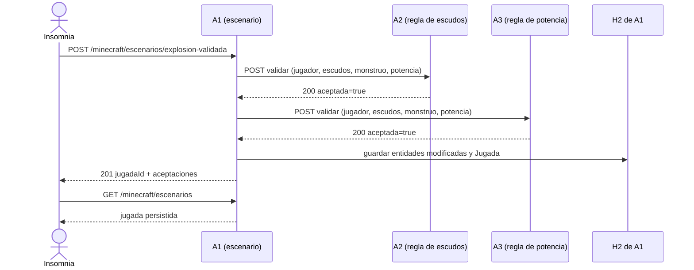
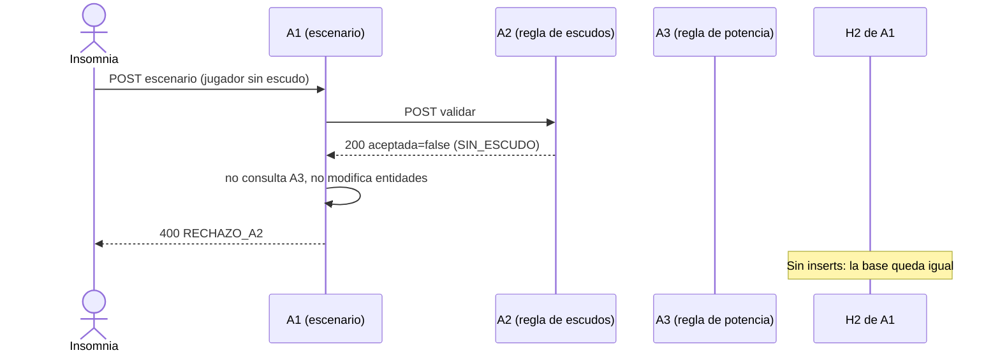
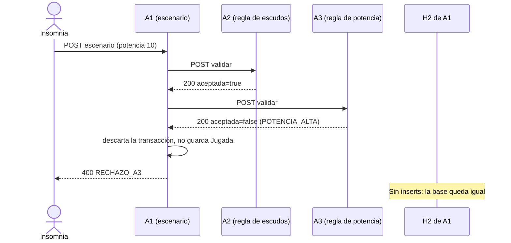
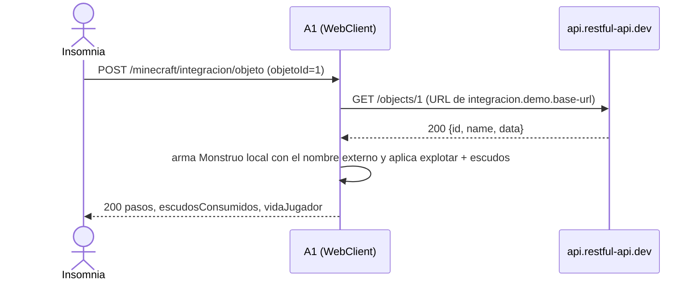

# POO-09 — Preparación del challenge de APIs cruzadas (Minecraft)

**Alumno:** Adrian (GitHub: `Adrian-312`)
**Rama de trabajo:** `poo09-preparacion`
**Estado:** infraestructura lista; faltan los datos reales del grupo (nombres de A2 y A3, URLs de sus OpenAPI y contratos).

Este documento deja preparado todo lo que depende sólo de este repositorio: OpenAPI propio, WebClient contra una API pública, URLs externalizables, logging debug, persistencia de la jugada y una colección de Insomnia con los tres caminos. El día del grupo se completan los datos marcados como **PENDIENTE** y se reemplazan los stubs por las APIs reales.

---

## 1. Cambios agregados al proyecto

| Pieza | Archivo | Función |
|---|---|---|
| OpenAPI + Swagger UI | `pom.xml` (`springdoc-openapi-starter-webmvc-ui:3.2.0`), `config/OpenApiConfig.java`, `application.properties` | Publica `/v3/api-docs` y `/swagger-ui.html`. Todos los controllers tienen `@Tag`; la simulación y el escenario tienen `@Operation` y `@ApiResponse`. |
| WebClient | `config/WebClientConfig.java`, `rest/integration/ExternalObjectClient.java` | Consulta `https://api.restful-api.dev/objects/{id}` con `WebClient` y combina el resultado con las reglas locales de explosiones y escudos. |
| Clientes de A2/A3 | `rest/integration/ReglaExternaClient.java` | Dos `WebClient` independientes, uno por compañero, con URL, ruta y timeout configurables. |
| Escenario persistido | `domain/Jugada.java`, `repository/JugadaRepository.java`, `service/EscenarioService.java`, `rest/controller/EscenarioController.java` | Consulta A2 y A3, persiste la jugada sólo si ambos aceptan y atribuye el rechazo. |
| Stubs temporales | `rest/controller/ValidacionStubController.java` | Simulan A2 y A3 mientras no existen los OpenAPI reales. Sirven para probar hoy el feliz y cada rechazo. |
| Errores | `rest/exception/GlobalExceptionHandler.java` | Traduce `RECHAZO_A2`, `RECHAZO_A3` (400) y `FALLO_A2`, `FALLO_A3` (502) al JSON de error del proyecto. |
| Log4j2 debug | `pom.xml`, `src/main/resources/log4j2.xml` | Logs DEBUG de cada paso de la integración en consola y en `logs/integracion.log`. |
| Insomnia | `insomnia/poo09-preparacion.json` | Camino feliz, rechazo por A2, rechazo por A3 y pedido de prueba al WebClient. |
| Enunciado aplicado | `docs/POO09-APLICADO.md` | Plantilla con A1, A2, A3, escenario en una frase y cómo probarlo. |

---

## 2. OpenAPI propio

- Documento: `http://localhost:8080/v3/api-docs`
- Swagger UI: `http://localhost:8080/swagger-ui.html`
- Versión de springdoc: **3.2.0** (corresponde a la línea Spring Boot 4.1.x).

Operaciones documentadas:

| Tag | Rutas |
|---|---|
| CRUD de entidades | `/minecraft/entidades`, `/minecraft/entidades/{id}` |
| Simulación de explosiones | `POST /minecraft/simulacion/explosion` (200 / 400 `ENTIDAD_INVALIDA` / 404 `ENTIDAD_NO_ENCONTRADA`) |
| Comportamiento del dominio | `/minecraft/acciones`, `/minecraft/explosivos`, `/minecraft/danio` |
| Integración de prueba | `POST /minecraft/integracion/objeto` |
| Escenario cruzado | `POST /minecraft/escenarios/explosion-validada`, `GET /minecraft/escenarios` |
| Stubs temporales A2/A3 | `/integracion/stub/a2/validar`, `/integracion/stub/a3/validar` |

Un compañero puede importar `/v3/api-docs` en Insomnia sin ver el código fuente.

---

## 3. Mapa A1 / A2 / A3

| Rol | Proyecto | Base URL | OpenAPI | Reglas publicadas (una frase) |
|---|---|---|---|---|
| **A1** | Adrian-312 / `avera-tplp3-2026` (este repo) | `http://localhost:8080` | `http://localhost:8080/v3/api-docs` | Onda expansiva (el Creeper muere y daña a todos) y escudos que absorben 5 puntos cada uno. |
| **A2** | **PENDIENTE** | Por defecto `http://localhost:8080/integracion/stub/a2` | **PENDIENTE** | Stub temporal: exige al menos 1 escudo en el inventario del jugador. |
| **A3** | **PENDIENTE** | Por defecto `http://localhost:8080/integracion/stub/a3` | **PENDIENTE** | Stub temporal: exige potencia de explosión no mayor a 8. |

En un trío los tres README deben anotar las mismas tres URLs. Cuando se conozcan los compañeros se reemplaza esta tabla y se configura:

```bash
A2_BASE_URL=http://localhost:8081 A3_BASE_URL=http://localhost:8082 \
A2_VALIDATE_PATH=/la-ruta-del-openapi-de-a2 \
A3_VALIDATE_PATH=/la-ruta-del-openapi-de-a3 \
./mvnw spring-boot:run
```

También se pueden pasar como `-D` a Maven o como variables de entorno del sistema. No hace falta tocar Java para cambiar de servidor.

---

## 4. Reglas usadas y escenario

**Escenario en una frase:** un Creeper de A1 explota contra un jugador que lleva escudos; la jugada solamente se guarda en el H2 de A1 si A2 acepta los escudos del jugador y A3 acepta la potencia de la explosión.

- Regla propia (A1): `Monstruo.explotar(potencia)` y `PersonajeJugable.recibirExplosion(potencia, origen)`.
- Regla temporal de A2: `escudosDisponibles >= integracion.stub.a2.escudos-minimos`.
- Regla temporal de A3: `potencia <= integracion.stub.a3.potencia-maxima`.
- Regla de la API pública de prueba: el objeto externo existe y aporta su `name` y sus `data` al monstruo local.

**Orden de consulta:** primero A2 y después A3. A2 revisa el estado previo del jugador (escudos); si falta ese requisito no tiene sentido consultar la potencia a A3. Si A2 acepta y A3 rechaza, A3 es el único autor del rechazo informado.

---

## 5. Cómo arrancar los tres servicios

Terminal 1 (A2, repo del compañero):

```bash
SERVER_PORT=8081 ./mvnw spring-boot:run
```

Terminal 2 (A3, repo del compañero):

```bash
SERVER_PORT=8082 ./mvnw spring-boot:run
```

Terminal 3 (A1, este repo):

```bash
SERVER_PORT=8080 \
A2_BASE_URL=http://localhost:8081 A2_VALIDATE_PATH=/ruta-real-de-a2 \
A3_BASE_URL=http://localhost:8082 A3_VALIDATE_PATH=/ruta-real-de-a3 \
./mvnw spring-boot:run
```

Si todavía no están los compañeros, este repo se puede arrancar solo; los stubs locales responden en `http://localhost:8080/integracion/stub/...`.

**Puerto externalizable:** `server.port=${app.puerto}` con `app.puerto=${SERVER_PORT:8080}`. Es la misma idea de la referencia de Baeldung sobre cambiar el puerto en Spring Boot.

---

## 6. Diagramas de secuencia

### 6.1 Camino feliz (limpio)



### 6.2 Rechazo de A2



### 6.3 Rechazo de A3



### 6.4 Prueba del WebClient contra la API pública



---

## 7. Respuestas y errores verificadas

| Caso | Código | Cuerpo / efecto |
|---|---|---|
| Feliz | 201 | `{"jugadaId":1,"jugadorId":6,"monstruoId":7,"potencia":6,"aceptadaPorA2":true,"aceptadaPorA3":true,"escudosConsumidos":2,"vidaJugadorDespues":20}` |
| Rechazo A2 | 400 | `{"status":400,"codigo":"RECHAZO_A2","mensaje":"Rechazo de A2: A2 exige al menos 1 escudo(s)... (código externo SIN_ESCUDO)"}` |
| Rechazo A3 | 400 | `{"status":400,"codigo":"RECHAZO_A3","mensaje":"Rechazo de A3: A3 admite como máximo potencia 8 (código externo POTENCIA_ALTA)"}` |
| Compañero caído | 502 | `{"status":502,"codigo":"FALLO_A2"}` o `FALLO_A3`, según quién no respondió. |
| API pública de objetos | 200 | `{"objetoId":"1","objetoNombre":"Google Pixel 6 Pro","potencia":10,"escudosConsumidos":2,"vidaJugador":20}` |

En los tres casos de escenario se comprobó con `GET /minecraft/escenarios` que la cantidad de jugadas sólo aumenta en el camino feliz.

---

## 8. Logging debug

`src/main/resources/log4j2.xml` define:

- `py.edu.uc.lp3.avera_tplp3_2026.rest.integration` → DEBUG.
- `py.edu.uc.lp3.avera_tplp3_2026.service` → DEBUG.
- Root → INFO para no inundar con logs de framework.
- Salida en consola y en `logs/integracion.log` (carpeta ignorada por Git).

Se registran: URL y payload de cada llamada, status y cuerpo recibido, decisión de cada compañero, vidas antes de la onda, jugada persistida y cantidad de filas antes/después.

---

## 9. Pasos para el día del grupo

1. Abrir los OpenAPI reales de A2 y A3 y copiar sus URLs al README y a `docs/POO09-APLICADO.md`.
2. Escribir en una frase la regla de cada compañero y decidir el orden de consulta.
3. Ajustar `ValidacionExternaRequest` y `ValidacionExternaResponse` a los nombres de campo del OpenAPI de cada compañero. No copiar clases Java ajenas.
4. Configurar `A2_BASE_URL`, `A2_VALIDATE_PATH`, `A3_BASE_URL` y `A3_VALIDATE_PATH`.
5. Ejecutar la colección Insomnia: setup, feliz, rechazo A2, rechazo A3 y `GET` final.
6. Guardar las respuestas reales de ejemplo en la colección y en el README.
7. Completar el enlace al commit de la solución en `docs/POO09-APLICADO.md` y en el README.
8. Si un compañero no responde, documentar el reintento y dejar registrado el código 502 obtenido.

---

## 10. Checklist del challenge

| Criterio | Estado | Evidencia |
|---|---|---|
| OpenAPI propio | Listo | `/v3/api-docs` y `/swagger-ui.html` con CRUD, simulación, errores, integración y escenario. |
| Round robin | Preparado | Mapa A1/A2/A3 en este documento y en el README; falta completar nombres y URLs reales. |
| Consumo | Listo con stubs y API pública | `ExternalObjectClient` y `ReglaExternaClient` usan WebClient con URLs externalizables; falta apuntar a los OpenAPI reales. |
| Escenario persistido | Listo con stubs | `POST /minecraft/escenarios/explosion-validada`, `GET /minecraft/escenarios` y colección Insomnia con feliz y ambos rechazos. |
| Corrección de POO-08 | **PENDIENTE** | falta confirmar si hubo puntaje completo, observaciones cerradas o no hay documento. |
